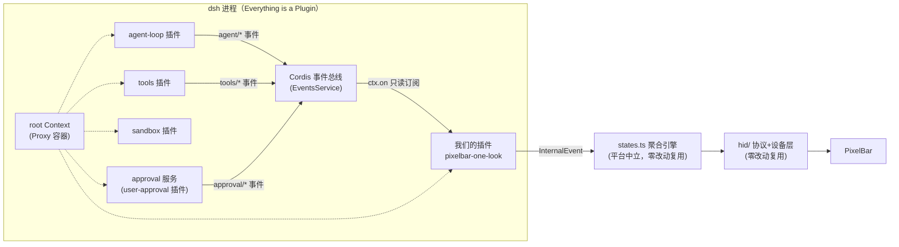
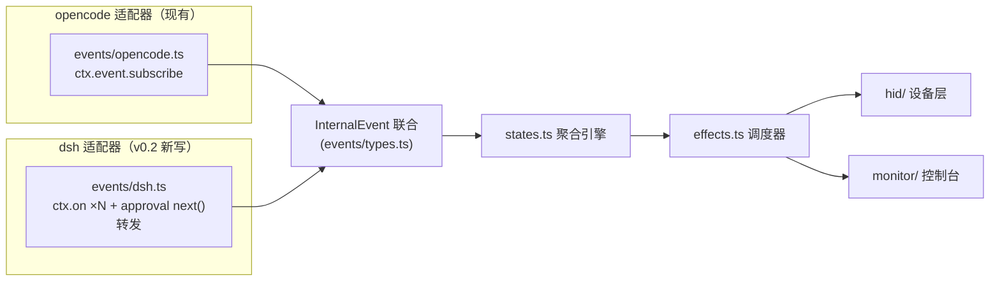
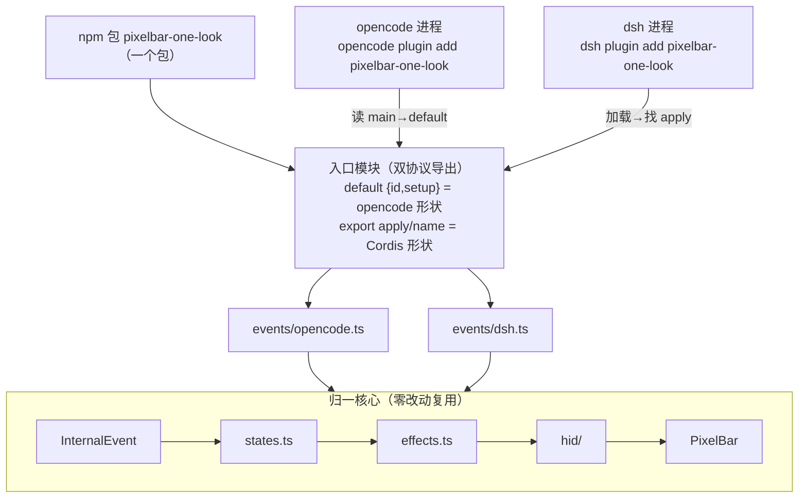

# DeepSeek Harness (dsh) 插件体系调研报告

> CARD.PB.20 ｜ 2026-11-17 ｜ 目的：评估把 pixelbar-one-look 状态灯移植到 dsh 的可行性、成本与路线，作为 v0.2 主任务的设计输入。
> 信息来源：dsh 官方仓库（deepseek-ai/deepseek-harness）docs 与源码 README、官方 Cordis 教程、社区深度解析文章（文末 §10）。
> 标注约定：**【实测待办】** = 文档/源码可见但本项目尚未真机验证的结论；**【缺口】** = 现有资料查不到、必须装 dsh 后探测的点。

## §0 结论摘要（TL;DR）

**结论：适合，且 dsh 的插件模型比 opencode 更贴合我们的架构。**

| 评估维度 | 结论 | 依据 |
|---|---|---|
| 插件能否观察到 agent 全生命周期？ | ✅ 能 | `agent/created` → `agent/session-start` → `agent/status` → `agent/pre-step`/`agent/step` → `agent/turn-stopping` → `agent/disposed`，事件链完整覆盖"开始/运行/等待/结束" |
| 审批等待（待批准）能否观察？ | ✅ 能 | `approval/request`（waterfall）+ `approval/asked`/`approval/decided` 审计对；观察者注册"只转发不答复"的 listener 即可 |
| 模型失败（红灯）能否观察？ | ✅ 能 | `agent/request-error`、`agent/error` |
| 多会话/多 Agent 聚合（我们的核心设计）？ | ✅ 原生多 Agent | AgentRegistry + Session 双注册表，`agent/created`/`agent/disposed` 成对事件，子 Agent 有 creator 关系（天然对应我们的 parentID 过滤） |
| 核心代码复用度 | ⭐ 高 | 平台隔离纪律（D02）已把宿主类型锁在 2 个文件；`hid/`/`lights/`/`monitor/` 全部平台中立，零改动复用 |
| 移植工作量预估 | M（1-2 会话） | 新写 `src/events/dsh.ts`（归一化适配器）+ dsh 入口（apply(ctx)）+ 发布形态适配 |
| 主要风险 | 事件 payload 形态 | dsh 迭代快（v0.2.2-rc），事件参数细节文档不完整，需装真机标定（同 opencode PB.04 的老路） |

一句话：**opencode 是"一个事件流订阅口"，dsh 是"类型化事件总线 + 依赖注入 + 可逆副作用"——我们的 InternalEvent 中立模型恰好是为这种场景设计的，映射面比 opencode 更干净。**

---

## §1 dsh 是什么

**DeepSeek Harness（dsh）** 是 deepseek-ai 开源的 Agent 运行时，口号 **"Everything is a Plugin"**：模型适配器、工具注册表、会话持久化、Agent 循环本身——全部是挂载在共享 Context 上的插件，没有特权内核。

| 项 | 说明 |
|---|---|
| 仓库 | `github.com/deepseek-ai/deepseek-harness`（monorepo，`packages/` 下数十个插件包） |
| 运行形态 | `npx @deepseek-ai/dsh web`（Web UI，默认 `127.0.0.1:3080`）；TUI/CLI 包另有 `@deepseek-harness-tui/dsh` |
| 版本 | v0.2.x（v0.2 桌面端已有图形化插件管理器） |
| 插件框架 | **Cordis**（cordiverse 社区的独立 TS 插件框架，DeepSeek vendor 进 `vendor/cordis/` 并做定制） |
| 插件哲学 | 官方文档原话："There is no privileged core to patch: you extend dsh by mounting a plugin beside the others." |
| 安装/分发 | npm 包 / `dsh plugin add github:you/hello-plugin`（git 安装直接拉源码）/ bundle（声明 `dsh.bundle` 的配置层包） |

与 opencode 对照：opencode 插件是"进程内脚本 + 单一 event.subscribe 流"；dsh 插件是"配置驱动的组件 + 类型化多模式事件总线"。dsh 的表达力强一档，但对**纯观察者**（我们）来说复杂度是可选项——只用 `ctx.on` 的 emit 观察即可，不必碰 waterfall/serial 的拦截面。

## §2 Cordis 核心架构：五大机制

dsh 的一切插件能力都由 Cordis 的五个原语组成：

| 机制 | 解决的问题 | 与本项目的关联 |
|---|---|---|
| **Context**（代理） | 消费者不 import 提供者，`ctx.tools` 经 Proxy 运行时解析，提供者可热换 | 我们只消费事件，不提供服务——用不到提供侧 |
| **Fiber**（插件状态机） | 依赖驱动的加载顺序，`inject` 未满足时停在 PENDING 而非报错 | 我们无服务依赖，大概率不需要 `inject`（**【实测待办】**确认是否需要声明宿主服务依赖） |
| **Effect**（可逆注册） | 一切注册自带反注册；卸载时逆序执行全部 disposer | **直接映射我们的单写者纪律**：HID 打开/关闭、monitor 端口监听全部包成 Effect，HMR 卸载自动清场 |
| **Service**（依赖注入） | `inject: ['x']` 声明依赖；提供者卸载时依赖者自动卸载、恢复时自动重载 | 同上，观察者不需要 |
| **Events**（五模式事件总线） | 观察/拦截/策略选择/并发协调各得其所（§3） | **我们的全部输入** |



插件三种形态（dsh 文档 `docs/user/develop/framework/index.md`）：

```ts
// 形态 1：函数插件（最常见，我们的选择）
export const name = 'pixelbar-one-look'
export function apply(ctx: Context) { /* ... */ }

// 形态 2：对象插件 { name, apply }
// 形态 3：Service 子类（要暴露具名服务时用；我们不需要）
```

Fiber 六态：`PENDING → LOADING → ACTIVE → UNLOADING → DISPOSED`（另有 FAILED）。热重载时旧实例 Effect 全部逆序卸载、新实例带新配置加载——**这对 HID 设备是重要保障**：插件重载不会泄漏设备句柄（前提：我们把设备关闭写进 disposer）。

## §3 事件系统：五种分发模式与内置事件目录

### 3.1 五种分发模式

Cordis 事件不是单一 emit，有五种模式（源 `vendor/cordis/src/events.ts`）：

| 模式 | 调用 | 语义 | 我们用吗 |
|---|---|---|---|
| `emit` | `ctx.emit(name, ...)` | 广播，不等待、无返回 | ✅ 全部输入走这个（配合 `ctx.on`） |
| `parallel` | `await ctx.parallel(...)` | 所有 listener 并发，await 全部 | ❌ |
| `serial` | `await ctx.serial(...)` | 顺序执行，第一个有效返回值获胜 | ❌ |
| `bail` | `ctx.bail(...)` | serial 的同步版 | ❌ |
| `waterfall` | `await ctx.waterfall(...)` | 洋葱中间件，listener 包裹后续；`next()` 放行、不调即截断 | ⚠️ 仅 `approval/request` 需要，且**必须永远 `next()` 转发**（只观察不答复） |

事件类型用 TS declaration merging 声明，`ctx.emit`/`ctx.on` 全类型化；事件名遵循 `namespace/action` 命名（一眼可见来源）。

**铁律级注意**（Cordis 文档强调的最常见错误）：waterfall listener 只观察/注记时**必须调 `next()`**，忘调会静默截断全部下游——在 `approval/request` 上犯这个错 = 抢答审批 = 破坏我们的架构铁律 2（禁止反向注入）。v0.2 必须加一条单测：**模拟 dsh 审批事件，断言我们的 listener 恒调 next() 且返回值透传**。

### 3.2 内置事件目录（状态灯视角）

dsh 明确区分两类事件（官方文档强调这是最常见的集成误区）：

- **Cordis live 事件**：`namespace/action` 命名，进程内实时分发，驱动即时行为；
- **durable session 事件**：`turn/*`、`step/*`、`tool/call`、`tool/result`、`compaction/*` 等持久化会话记录，**不是同名 Cordis 事件**，观察要订阅 `session/event` 再看 `event.type`。

状态灯关心的主事件（dispatch 模式以源码/文档标注为准，**【实测待办】**逐项确认 payload）：

| Cordis 事件 | 模式 | 时机 | 对应 opencode 事件 |
|---|---|---|---|
| `session/created` | emit | 会话建立（先于 agent/created） | session.created |
| `agent/created` | emit | Agent 组装完成、进注册表（成对 `agent/disposed`） | session.started |
| `agent/session-start` | emit | 首个启动驱动边界，携带 SessionStartSource | session.execution.started |
| `agent/status` | emit | **运行态转移**（running 等状态机变化） | （无直接对应，比 opencode 更直白） |
| `agent/pre-step` | waterfall | 每步组装前，可否决/改写 | — |
| `agent/step` | emit | 一步执行完毕 | session.step.* |
| `agent/step-result` | waterfall | 助手消息后处理 | — |
| `agent/request` | waterfall | 模型调用（可改路由/参数） | （推理增量无对应，dsh 无 token 级流事件给观察者？**【缺口】**） |
| `agent/request-error` | emit | **模型请求失败** | session.execution.failed |
| `agent/error` | emit | Agent 级错误 | error |
| `agent/turn-stopping` | serial | turn 无后续工具/转向，将停止 | session.step.ended |
| `agent/inbox/inserted·claimed·discarded` | emit | 用户输入入队/认领/丢弃 | user.active 语义可从 claimed 推 |
| `tools/pre-execute` | waterfall | 工具执行前策略（allow/deny/**ask**） | permission.* |
| `tools/execute` / `tools/post-execute` | waterfall | 执行包裹 / 结果检查改写 | — |
| `tools/result` | emit | 工具最终冻结结果 | session.tool.success/failed |
| `approval/request` | waterfall | **审批请求**：答复者（渠道插件）拥有则答复，否则 `next()` 转交 | permission.asked |
| `approval/asked` / `approval/decided` | 审计对 | 审批问答必须 turn 包裹的审计事件 | form.created / form.replied |
| `session/event` | emit | 持久会话事件统一出口（看 `event.type`） | （opencode 无此二分） |

审批子系统细节（`packages/interaction/user-approval`）：

- `ApprovalPolicy = 'ask' | 'never' | …`；策略外置于服务，答复者是 **channel 插件注册的 waterfall listener**（ACP bridge、宿主适配器等）；
- pending 审批是**进程内**状态（checkpoint 恢复不重放）；
- 有社区插件围绕它做产品（dsh-im-connect：IM 里远程批/拒工具）——说明审批观察面是稳定公开的。

**关键推论**：我们的插件在 `approval/request` 上应注册"幽灵答复者"——收到即记 `permission.asked`，无条件 `next()` 转交真实答复者。这比 opencode 的 permission.asked 更干净：**一个事件点、确定性顺序、类型化签名**。

### 3.3 事件命名与类型声明（写法示例）

```ts
import type { Context } from '@deepseek-ai/cordis'

export const name = 'pixelbar-one-look'

export function apply(ctx: Context) {
  // ctx.on 本身是 Effect：插件卸载时 listener 自动移除
  ctx.on('agent/step', (step) => { /* → InternalEvent */ })
  ctx.on('agent/request-error', (err) => { /* → InternalEvent.error */ })
  ctx.on('tools/result', (exec, result) => { /* → InternalEvent.tool.* */ })
  ctx.on('approval/request', async (req, next) => {
    note('permission.asked')
    return next()            // 铁律：只观察，永远转发
  })
  // HID 句柄用 Effect 兜底：卸载自动关设备
  ctx.effect(() => {
    const holder = openDevice()
    return () => holder.close()
  })
}
```

## §4 插件的开发、配置与分发

### 4.1 开发闭环

1. 写一个 `.ts`：`export const name` + `export function apply(ctx)`；
2. 本地装载：项目 `cordis.patch.yml` 加一行 `- insert: [{ id: pixelbar, name: './plugins/pixelbar-one-look.ts' }]`；
3. `dsh --profile web` 启动即加载；改配置热重载（旧实例自动清理）。

配置组织（dsh 的组合即产品）：

- **Bundle** = 声明 `dsh.bundle` 的 npm 包，内含 YAML 配置层（"这包装了哪些插件+什么设置"）；
- **Profile** = bundle 的有序栈，后层覆盖前层（`web profile = dsh-base + dsh-web-app + 用户 cordis.patch.yml`）；
- `dsh --profile web --dump-config` 可打印全量插件树——**调试利器，v0.2 开发时先用它确认我们的插件加载形态**。

### 4.2 分发渠道（对我们发布策略的影响）

| 渠道 | 命令/形态 | 备注 |
|---|---|---|
| npm 包 | 桌面端插件管理器输 npm 包名；或 cordis.patch.yml 引包名 | 与 opencode 的 `opencode plugin add <pkg>` 等价 |
| git 直装 | `dsh plugin --profile demo add github:you/hello-plugin` | **拉源码不拉构建**——TS 源码即发布物，与我们 opencode 发布形态（main=src/index.ts，Bun 直跑 TS）理念一致 |
| bundle | 打包多插件+配置 | 我们**不需要**：单插件直接发布即可 |

结论：**一个 npm 包、两个宿主**是可行的——包内并存 `src/index.ts`（opencode 入口）与 dsh 入口，互不干扰；也可以拆 `pixelbar-one-look-dsh` 子包（v0.2 时按包体积/依赖差异定，属 B 级决策）。

### 4.3 生命周期与清理

- `apply()` 全部注册自带 Effect；`ctx.effect(() => { ...; return disposer })` 兜底非托管资源（我们的 HID）；
- `ctx.plugin(child)` 子插件随父卸载；
- HMR：配置变更 → 旧 fiber UNLOADING（disposer 逆序）→ 新 fiber 加载；
- **对我们的映射**：`index.ts` 现有的 cleanup 逻辑天然对应 disposer；单写者队列 + 端口监听 + liveness 日志全部进 Effect。

## §5 社区插件生态盘点

| 项目 | 形态 | 与我们的关系 |
|---|---|---|
| `@feiyang666/dsh-usage-plugin` | npm 包：token 用量/成本记录、热力图、导出 | **最接近的先例**——纯观察型插件（监模型调用记账），证明"观察 agent 行为做侧翼产品"在 dsh 生态成立 |
| `Mt-Youya/dsh-plugins` | 合集 bundle（一个包装全部，也可单装） | bundle 分发形态参考 |
| `axyatech/rea-harness-plugin` | MCP server + workflow skill + 侧栏面板 | "多能力一包"参考；我们反向——单能力轻包 |
| `dsh-im-connect` | IM 远程审批（群/私聊里批/拒工具） | **审批瀑布流的成熟用例**，`approval/request` 观察面稳定的证据 |
| `@argszero/cordis-plugin-goal-ask-guard` | npm：agent 级 ctx.tools.guard()，拦自主轮中的 ask 工具 | 展示 agent-scoped listener（只收本 Agent 事件）的用法 |
| `@canonmsg/deepseek-harness-plugin` | npm 模板/示例 | 脚手架参考 |

生态判断：dsh 插件生态**年轻但活跃**（模板、合集、垂直工具均已出现），尚无任何"硬件状态灯/物理通知"类插件——**PixelBar 状态灯在 dsh 生态同样是第一个**，先发窗口存在。

## §6 opencode ↔ dsh 架构对照

### 6.1 宿主 API 面

| 维度 | opencode 2.x | dsh (Cordis) |
|---|---|---|
| 入口签名 | `export const Plugin: (ctx) => {..}`（ ducks-typed） | `export function apply(ctx)` + `export const name` |
| 事件订阅 | 单一口：`ctx.event.subscribe(cb)`，一个泛型流 | 类型化多点：`ctx.on(name, cb)` × 五模式 |
| 事件粒度 | 平铺字符串 type + 动态 data（form.created 嵌套坑） | `namespace/action` 强约定 + TS 声明合并强类型 |
| 生命周期清理 | 手动 cleanup（我们自己管） | Effect/disposer 自动化（框架管） |
| 配置 | ctx.options | cordis.patch.yml / bundle / profile |
| 多会话识别 | sessionID + session.list() 播种 title | AgentRegistry/Session 双表；子 Agent 有 creator 关系 |
| 热重载 | 无（改代码重启 opencode） | 有（HMR，fiber 逆序清理） |
| 运行时 | Bun（宿主内嵌） | Node.js ≥18 |
| 事件文档成熟度 | 单一事件流、字段靠实测 | 事件目录文档化（cordis-catalog/events.md），但 payload 细节仍需实测 |

### 6.2 事件 → InternalEvent 映射表（v0.2 设计基线）

我们的 `src/events/types.ts` InternalEvent 联合是平台中立的——两个适配器各喂一个：



| InternalEvent（平台中立） | opencode 来源（现有） | dsh 来源（v0.2） | 置信度 |
|---|---|---|---|
| working（开始执行） | session.execution.started | `agent/session-start` + `agent/status`(running) | 高 |
| working 心跳 | tool.called / text.delta | `agent/step`、`tools/result`（工具活性的替身） | 中（**【缺口】**无 token 级流，working 心跳粒度变粗，需评估 10s 窗口判活逻辑是否受影响） |
| tool.started | session.tool.called | `tools/pre-execute`（waterfall，我们 next() 转发）或 session/event 的 `tool/call` | 高 |
| tool.success / failed | session.tool.success / .failed | `tools/result`（result 判性） | 高 |
| error（模型失败） | session.execution.failed | `agent/request-error` / `agent/error` | 高 |
| permission.asked | permission.asked / form.created | `approval/request`（观察转发）+ `approval/asked` | 高 |
| permission.resolved | permission.resolved / form.replied | `approval/decided` | 高 |
| done（轮次完成） | session.execution.succeeded / step.ended | `agent/turn-stopping` + session/event `turn/end` | 中高 |
| interrupted（打断回默认） | session.interrupted | **【缺口】**：打断是否有独立事件未查到；或从 `agent/status` 转移推断 | 低——最大待验证点 |
| session.started / renamed | session.created / renamed / session.list() | `session/created` / `agent/created`；**【缺口】**：会话 title 机制未查到，别名链 title→project→S 可能退化为 project→S | 中 |
| 子会话过滤 | parentID != null 跳过 | Agent creator 关系（root=undefined）→ 天然对应 | 高 |
| user.active（清完成队列） | user.active | `agent/inbox/claimed`（用户输入被认领） | 中 |

### 6.3 结构对比后的三个判断

1. **dsh 的类型化事件让适配器更薄**。opencode 适配器里大量防御性解析（pickSessionID fallback、basename 浓缩、v1/v2 形态兼容）在 dsh 侧基本不需要——事件签名类型化、`namespace/action` 命名稳定。
2. **审批面 dsh 更干净**。opencode 靠权限规则配置才触发 permission.asked，且 form.created 有嵌套坑（PB.R5b 实证）；dsh 的 approval/request 是稳定瀑布流，政策（ask/never）由用户配置驱动，观察零成本。
3. **多会话模型 dsh 更丰富也更陌生**。opencode 是"扁平 sessionID 集合"；dsh 是"Agent（作用域 ctx）× Session"双层，还有 agent-scoped listener（只收本 Agent 事件）。我们的聚合引擎按 sessionID 聚合——v0.2 需要决定映射粒度：**1 Agent = 1 台账条目**（倾向此案，Agent 才是"一次任务"的边界），Session 维度折叠。B 级决策，PB.21 定。

### 6.4 共存、归一与用户安装（发布形态设计）

**三问三答：**

**Q1 两个宿主插件能共存吗？** —— **能，且是包级共存、进程级互斥。** opencode 与 dsh 是两个独立进程，各自只加载自己的入口；D02 隔离纪律保证两个适配器零交叉 import，同一进程里永远只有一套宿主代码在跑。仓库/包层面共存 = 两个薄入口文件并存，互不感知。

**Q2 能归一吗？** —— **核心早已归一（这正是 D02 的设计回报），宿主面归一到"一模块双导出"。** InternalEvent + 聚合引擎 + HID 层是唯一实现；两个入口只在"事件源形状 + 生命周期挂钩"上有差异。可再进一步：**单入口文件同时导出两种协议形状**——`export default { id, setup }`（opencode 读 main 拿 default）+ `export function apply(ctx)` / `export const name`（Cordis 找 named export），各入口函数各自接线，无需运行时探测。宿主类型仍全部锁在这一个文件 + 两个适配器里，D02 纪律不破。（B 级决策，PB.22 定：单模块双导出 vs 双入口文件。）



**Q3 用户如何区分装哪些文件？** —— **用户不选文件，只选自己宿主的安装命令。** 包名只有 `pixelbar-one-look` 一个，各宿主的插件管理器自动找到自己的入口：

| 用户 | 安装命令 | 宿主自动接线 |
|---|---|---|
| opencode 用户 | `opencode plugin add pixelbar-one-look` | main → default 导出 → opencode 路径 |
| dsh 用户 | `dsh plugin add pixelbar-one-look`（或 cordis.patch.yml 引包名） | 模块 `apply` 导出 → dsh 路径 |
| 双宿主用户 | 两条命令各装一次（同一个包） | 互不干扰——见 R9 并发仲裁 |

不存在"opencode 版文件 / dsh 版文件"让用户挑；README 只需一张"你是哪个宿主 → 跑哪条命令"的表。

### 6.5 双宿主同机并发：单写者原则的进程外边界（新风险域）

v0.1 单写者原则只管单进程；双宿主用户会制造**两个进程争一台 PixelBar**的场景（node-hid 各自 open 同一设备，Windows 共享模式行为**【实测待办】**）。候选仲裁方案：

| 方案 | 做法 | 被否因素/代价 |
|---|---|---|
| A. 设备占用锁文件 | 打开设备前原子创建用户级锁文件（如 `~/.pixelbar-one-look.lock`，含 PID+心跳）；拿不到锁 → 降级 monitor-only（Web 控制台照常，灯不写） | 多 ~60 行 + 心跳时序；但语义清晰、跨平台 |
| B. 先到先得 + open 失败降级 | 直接依赖 node-hid open 失败（Windows 默认不共享） | 行为依赖 OS/hidapi 细节，不可移植；可能两进程都"半开" |
| C. 文档声明 + 用户自律 | README 写明"同机只装一处" | 零代码，但把工程问题推给用户 |

**裁决（D19，2026-11-17 用户拍板）**：**v0.2 采方案 C**（README 写明"同一台机器 + 同一台 PixelBar，只在一个宿主启用插件"）；方案 A（锁文件 + monitor-only 降级）**移 v0.3 立卡**；方案 B 否决（不可移植）。

## §7 复用度评估（分层盘点）

| 层 | 文件 | v0.2 动作 | 复用率 |
|---|---|---|---|
| 协议层 | `hid/protocol.ts` | 零改动 | 100% |
| 设备层 | `hid/device.ts`（node-hid 动态加载、单写者队列、Mock） | 零改动（Node ≥18 与 dsh 运行时匹配） | 100% |
| 聚合引擎 | `lights/states.ts`（优先级压缩/轮播/双预算） | 零改动（多 Agent 粒度由适配器保证） | 100% |
| 输出调度 | `lights/effects.ts` / `loop.ts` / `clock.ts` | 零改动 | 100% |
| 控制台 | `monitor/monitor.ts` | 零改动（端口/面板逻辑平台无关） | 100% |
| 集成测试 | `integration.test.ts` + TC 用例库 | 复用（事件注入源从 opencode 用例换 dsh 用例） | ~90% |
| 事件类型 | `events/types.ts` | 零改动（这正是 D02 的回报时刻） | 100% |
| opencode 适配器 | `events/opencode.ts` | 不动 | — |
| **dsh 适配器** | `events/dsh.ts` | **新写**：§6.2 映射表落地 + approval next() 转发纪律 + 打断/title 两缺口实测 | 0% |
| **dsh 入口** | 新文件（如 `src/dsh.ts`） | **新写**：apply(ctx)、Effect 包设备、配置读取 | 0% |
| 测试 | `events/dsh.test.ts` | **新写**：映射断言 + next() 恒转发断言 + Mock 事件源 | 0% |

工作量定级：新写面积 ≈ 当年 `events/opencode.ts` + `index.ts` 的量，且无协议风险（HID 层已铁）。**M 级（1-2 会话）成立**，其中约一半是"装真机标定事件 payload"的实测工作（重演 PB.04）。

## §8 风险与待实测清单

| # | 项 | 风险 | 缓解 |
|---|---|---|---|
| R1 | 事件 payload 形态未实测（文档只有目录级） | 映射表字段名猜错 | ✅ **已闭环（2026-11-17 实测）**：权威信号源为 `session/event`（`args=(session, event)`，按 event.type 分发）；详见详细设计 §10.3 实测定稿 |
| R2 | `interrupted` 语义缺口 | 打断不回默认灯（v0.1 用户最重视的行为之一） | ⬜ **留自然触发**（agent/disposed 兜底已实现+单测锁定；error 同）——与 v0.1 同处理方式 |
| R3 | 会话 title 机制未知 | 完成轮播/待批准屏显退化 | ⚜️ **部分闭环**：session/created 实测无 title 字段，别名退 project→S（实测"S1 完成"正常）；接 session 标题留后续版本 |
| R4 | working 心跳粒度变粗（无 token 流观察口） | 长推理期间 10s 窗口判活误判 idle | ✅ **已闭环**：session/event 的 step/*、tool/* durable 事件全程心跳（实测 pwsh/write/read 工具流密集触发） |
| R5 | `approval/request` waterfall 误截断 | **抢答审批 = 破坏铁律 2，最严重** | ✅ **已闭环**：恒 next() 纪律 + TC-DA2 锁死；实测 approval/request 与 approval/asked 双通道均到达（重复置 waiting 无害） |
| R6 | dsh 迭代快（v0.2.2-rc），事件面可能变动 | 升级即碎 | ⚜️ 持续项：durable 事件类型（13 核心）为官方稳定契约面；live 事件按官方 asar 目录订阅 |
| R7 | Node 版本/node-hid 原生模块与 dsh 运行时 | 装不上/加载失败 | ✅ **已闭环**：桌面运行时 Node 24.21 直载 TS 源码实测通过；node-hid 动态加载静默降级有效（无真机 monitor-only 正常） |
| R8 | 我们插件进程模型：web/TUI/CLI 三形态哪个进程跑插件 | 灯只在一个形态下亮 | ✅ **已闭环**：CLI/网页版与桌面 GUI 均实测装载成功——同一 Cordis 装载机制，插件宿主通用 |
| R9 | **双宿主同机并发**：opencode 与 dsh 两进程争一台 PixelBar（§6.5） | 灯效互踩、HID 句柄竞争、行为不可预期 | **已裁决（D19）**：v0.2 方案 C；实测补充：monitor 端口被占时实例自动顺延（18890→18891），无互踩 |
| R10 | dsh 从 npm 包加载入口的寻址方式 | `dsh plugin add` 装上但加载不到 apply 导出 | ✅ **已闭环（装载器源码实证）**：`unwrapExports` 优先拆 default——入口必须用 exports 子路径 `pixelbar-one-look/dsh`（无 default 导出）；insert 列表包裹、config 第二参数、pnpm link 活链、HMR 热重载全部定案 |

## §9 v0.2 实施路线建议（已并入 TASKS.md 卡）

**CARD.PB.21 · dsh 事件归一适配器**（M）
1. 安装 dsh（`npm i -g @deepseek-ai/dsh`），跑通 `dsh web`，本地 patch 装载一个 hello 观察插件；
2. logEvents 通道移植：dump 三场景（执行中/审批/失败+打断）全量事件 payload；
3. 按 §6.2 映射表落地 `src/events/dsh.ts`，R2/R3/R4 缺口逐项关闭；
4. `events/dsh.test.ts`：映射断言 + approval 恒 next() 断言 + 防御性解析单测；
5. 文档同步：本报告 §6.2 表标注"实测确认"，灯效映射.md 增补 dsh 事件列。

**CARD.PB.22 · dsh 插件入口 + 装载验证**（M）
1. dsh 入口（apply + Effect 设备托管 + 配置：端口/灯效偏好）；
2. 真机联调：PixelBar 接 dsh 实跑五状态；
3. 发布形态决策（B 级）：单包双宿主 vs 子包；
4. 文档：README 增 dsh 安装节；真机手册增 dsh 标定剧本。

依赖顺序：PB.20（本报告）→ PB.21 → PB.22。PB.21 的第 1-2 步需要用户机器上有 dsh 环境（或经确认后由代理安装——涉及全局 npm 安装，按权限规则属用户拍板）。

## §10 参考资料

官方源：
- `github.com/deepseek-ai/deepseek-harness` — 主仓库；`docs/architecture.md`、`docs/subsystems/core.md`、`docs/cordis-catalog/events.md`
- 官方插件开发文档：`docs/user/develop/framework/{index,service,events}.md`、`docs/user/develop/basic/{index,publish}.md`
- Cordis API：`docs/cordis-api/context.md`（EventsService/RegistryService 混入说明）、Cordis 教程 `docs/cordis-tutorial/04-events.md`
- 源码级依据：`vendor/cordis/src/{context,fiber,service,events}.ts`、`packages/core/agent-loop/README.md`、`packages/core/tools/README.md`、`packages/interaction/user-approval/`

社区深度解析（本报告 §2/§3/§6 的交叉验证源）：
- Wonder Lab《DeepSeek Harness Series (02): Everything Is a Plugin — A Deep Dive into Cordis Core Design》（home.wonlab.top，2026-09-10，含源码逐段讲解）
- guibai.dev《DeepSeek Harness: A Plugin Runtime Where the Agent Loop Itself Is Replaceable》及同站 Cordis mini-runtime 实作
- ai-develop.top《dsh-plugin-practice》（事件/waterfall/inject 实操样板）
- floatboat.ai《Cordis Plugin Framework: Services Inside DeepSeek Harness》
- dsh-docs.pages.dev / deepseekdocs.com / deepseekplugin.org — 第三方文档镜像（事件目录补充）

社区插件实例：见 §5 表格。

---

**报告结论行动项**：本报告作为 CARD.PB.20 交付物；PB.21/PB.22 已入 TASKS.md v0.2 板块。下一步行动 = 安装 dsh 真机 + 事件 dump（需用户确认安装方式）。
