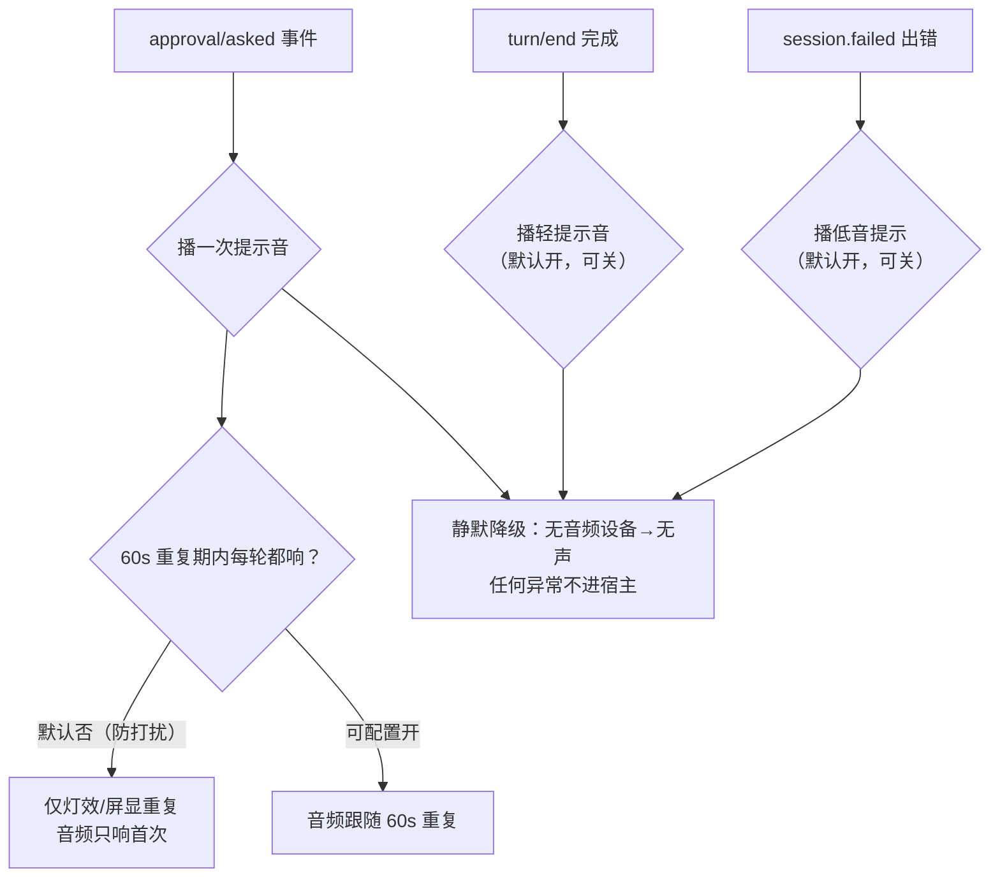

# v0.3 前瞻探索：信息纵深 + 音频通知

> 立项：2026-11-18 ｜ 状态：探索阶段（实施卡待本文档批准后立）
> 定位钉死：PixelBar = **环境状态显示设备**（ambient display）。扩展轴是**更多信息**，不是**更多交互**。
> 本文进公开面（随 npm 包与公开仓发布），按隐私门标准撰写。

## §0 结论摘要（TL;DR）

| 子项 | 一句话效果 | 可行性 | 优先级 |
|---|---|---|---|
| **完成时长** | 完成屏显 "S1 完成 4分12秒" | ✅ 零新事件（turn 起止时间差），纯内部计算 | **P0** |
| **音频通知** | 审批等待 "叮" 一声——人走开也能被打断 | ⚜️ 待真机验证一条：PixelBar 是否注册为系统 USB 音频输出 | **P0**（验证后实施） |
| **token 用量** | 完成屏显 "完成 3.2万tok" | ✅ 双宿主均有 usage 事件源（opencode `session.usage.updated` 实测在流；dsh `request/header` durable 事件） | P1 |
| **多项目色彩** | 并行项目各持一种流光色调，不读字即知是谁 | ✅ opencode 已有 project 字段；dsh 需补工作区锚点探测 | P1 |
| **todo 进度** | 完成屏显 "12/12" | ⚜️ 需解析 todo 工具调用参数（宿主间参数形态不一，较脆弱） | P2 |
| 语音助手 | — | ❌ **永不立项**（见 §3） | 不做 |

共同点：**全部零新增 npm 依赖**，全部在"观察者"边界内（只消费事件、只写显示/播放），不触碰产品形态。

## §1 信息纵深：让 10 秒屏显窗口承载更多

现状：文字通道只显示 "别名 + 状态词"（"S1 完成"），信息密度低。四个增量子项按数据可得性排序：

### 1.1 任务时长（P0——成本最低、纯内部计算）

- **效果**：完成文字从 "S1 完成" 变为 "S1 完成 4分12秒"；错误态同理可加时长。
- **事件源**：无新增——turn 起止时间差在聚合引擎内已有（`turn/start`→`turn/end` / opencode `session.execution.started`→`succeeded`）。
- **屏显预算**：compose 双预算（16 字符/48 字节）内 "完成4分12秒" 完全放得下（约 10 字符）。
- **风险**：零。时长格式化（分/秒、超 1 小时转 "1时23分"）是唯一实现细节。
- **设计张力（明确否决的部分）**：working 态的**进行中**时长显示（屏上滚 "已跑 23 分钟"）与既有决策 "working 态零文字"（文字通道专注通知）冲突——**不做**。进行中时长的正确载体是音频（§2 的长任务提示音，可选配置）。

### 1.2 token 用量（P1）

- **效果**：完成屏显追加本轮 token 消耗 "S1 完成 3.2万tok"；也可在错误态显示（失败也烧钱）。
- **事件源**：
  - opencode：`session.usage.updated`（payload 形态已标定，2026-11-19 实测 dump）：`{sessionID, cost, tokens:{input, output, reasoning, cache:{read, write}}}`——token 数据齐全且实时；DB 侧 part 表 step part 同构（734 条实证）。
  - dsh：durable SessionEvent 的 `request/header`（13 核心类型之一，携带模型请求头部；实测会话缓存中 token 测量数据齐全：input/output/cacheRead 等）。
- **累计值坑（实现关键）**：usage 事件是**会话累计值**（实测单轮 8M input / 615M cache.read 量级）——显示"本轮消耗"须在 execution.started 记基线、succeeded 时差值；跨轮持久无需落盘（基线在内存态工厂随会话登记，PB.31 同款）。
- **金额（2026-11-19 校准后的新结论）**：opencode 事件/DB 均带 `cost` 字段，但值依赖宿主价目库——自建网关 provider 价目为空 → cost 恒 0（实测 734 条全 0、价目库 cost=[]）；**官方定价 provider 场景宿主会直接算好金额**。由此金额显示三档：① cost>0 时直接显示（零维护）；② 只显示 token（原方案）；③ **用户自配单价折中**（opencode.jsonc 填 ¥/百万tok，插件只做乘法——零维护永不过时，用户自己知道自己的单价）。选型待用户拍板。
- **风险**：opencode payload 已消；dsh request/header 的 token 字段形态仍需实施时标定一轮（中）；显示无风险。

### 1.3 多项目色彩区分（P1）

- **效果**：多项目并行时，working 流光按项目持有稳定色调（项目名散列 → 固定 8~12 色板）——不读屏即知"是谁在跑"。
- **事件源**：opencode 的 project 字段（目录名）已在台账中 ✅；dsh 当前无工作区锚点（会话别名只有 S 序号）——需探测 dsh 的 workspace 服务/会话-工作区关联事件。
- **设计边界（重要）**：色调**只调制 working 流光**。waiting（动态光影）、error（红灯）、done（涟漪）保持既有语义色——状态语义的辨识度优先于项目身份，不允许"项目色"稀释"状态色"。
- **风险**：色板与状态色冲突需一轮真机观感校准（S 级）；dsh 侧锚点探测是前置依赖。

### 1.4 todo 进度（P2）

- **效果**：完成屏显 "12/12" 或进行中任务的进度（后者与 working 零文字冲突，仅完成态显示）。
- **事件源**：两宿主都有 todo 工具，进度在**工具调用参数**里（todo_write 的 items 数组）——解析参数可行但形态随宿主版本漂移，且 agent 用不用 todo 是自由的（信息可有可无）。
- **定位**：价值中等、脆弱度中等——排 P2，等 1.1/1.2 落地后看真实需求呼声再决定做不做。

## §2 音频通知：审批等待的"叮"一声

### 2.1 为什么音频是最高价值增量

灯效解决"你在屏幕前"的场景；**人走开后，审批等待是唯一真正需要打断你的事件**——现在它只有视觉通道（10s 文字 + 60s 灯效重复），你人不在场就全miss。而 PixelBar 恰好是**音箱**：它的本职就是出声。

### 2.2 通道可行性（一条待验证 + 一条备选）

| 通道 | 原理 | 前提 | 判定 |
|---|---|---|---|
| **A. 系统音频输出** | PixelBar 作为 USB 音频设备（USB speaker 几乎必然注册为系统标准音频输出）；插件播放内置 WAV 经系统默认输出送达 | **待真机验证**：声音设置里是否出现 PixelBar 输出设备（用户 30 秒可确认） | 主路线 |
| **B. HID 内置音触发** | 厂商 App 的提示音/闹钟若走 HID 命令触发设备内置音源，则可从协议层直接触发——无需设备当系统扬声器 | **待协议探测**：厂商 App 触发提示音时有无 HID 流量（本项目已有完整抓包经验） | 备选（更优雅但未知） |

A、B 不互斥：A 保底可用即立项，B 探测成功则叠加为"协议级原生通知"。

### 2.3 零依赖实现路径（A 通道）

- 音频资产：3~4 个内置 WAV（审批"叮"/完成"轻提示"/错误"低音"），每个 <50KB，随包发布。
- 播放：**不引入任何 npm 音频库**——走各 OS 原生播放器（Windows: PowerShell `System.Media.SoundPlayer`；macOS: `afplay`；Linux: `paplay`/`ffplay`），平台差异按铁律 5 收敛在独立模块（如 `src/audio/player.ts`，与 `hid/` 平台层同模式）。
- 失败静默降级（铁律 1）：无音频设备/播放器缺失 → 降级为无声，绝不可影响插件主链。

### 2.4 通知策略（与现有节律的耦合）

- **审批音频只响首次**（默认）——60s 灯效重复继续走视觉，避免人不在场时空房间反复"叮"的骚扰；等待超 10 分钟仍无人响应，可选触发第二次（escalation，配置项）。
- 完成/错误的音频默认**轻而短**（<1.5 秒），与设备自身音量走系统级（插件不碰设备音量——音量是厂商固件的地盘）。
- 全部行为进配置（`audio: on/off`、`audioEvents: [...]`），与现有 PluginOptions 同构。

## §3 负向清单：明确不做的事

| 不做 | 理由 |
|---|---|
| **语音助手**（ASR/TTS/对话） | 设备无麦克风阵列；ASR 引擎违反零依赖铁律；"看一眼"变"听一段"背叛产品名 |
| **音乐律动** | 设备原生功能（厂商 App 已做），重复造轮子且需要音频分析（重依赖） |
| **把设备变通用输入** | 无按钮、HID 输入通道未证实；唯一存疑项"触摸 HID"即使探测成功也只允许一个手势（拍一拍=清除完成队列），不做通用交互 |
| **通知历史/消息中心** | 16 字符屏装不下；深度信息归 Web 控制台（已有）管 |
| **屏显时钟接管/像素游戏等花活** | 脱离状态灯本分，每项都是纯成本 |

## §4 可行性矩阵与优先级

| 子项 | 价值 | 实现成本 | 新依赖 | 事件源成熟度 | 优先级 |
|---|---|---|---|---|---|
| 完成时长 | 中高 | 极低（格式化函数） | 零 | ✅ 内部已有 | **P0** |
| 音频通知 | 高（补齐"人不在场"场景） | 中（3 个 WAV + 平台播放器封装） | 零 | ✅ 纯消费既有事件 | **P0**（待 §5 验证①） |
| token 用量 | 中 | 低（追加屏显） | 零 | ⚜️ 双宿主 payload 各标定一轮 | P1 |
| 多项目色彩 | 中（多项目用户高） | 中（色板 + 观感校准） | 零 | ⚜️ dsh 锚点待探测 | P1 |
| todo 进度 | 中 | 中（脆弱参数解析） | 零 | ⚜️ 双宿主工具参数形态不一 | P2 |

## §5 需要真机验证的清单（归用户，各 ≤1 分钟）

1. **USB 音频确认**（决定 P0 音频立项）：插好 PixelBar → Windows 声音设置 → 输出设备列表里是否出现 PixelBar/EDIFIER 设备？出现后随便播个声音确认出声。
2. **厂商提示音通道观察**（决定 B 通道去留）：下次用厂商 App 触发设备提示音/闹钟时留意——它走系统音频还是设备自己响（屏幕没亮也会响 = 可能是 HID 触发的内置音）。
3. **触摸 HID 探测**（存疑项，可选）：开着本插件 Web 控制台的事件日志，摸一摸/拍一拍设备表面，看有无 HID 输入报告出现（有 → 输入通道立项候选；无 → 输入通道彻底关闭）。

## §6 风险与开放问题

| # | 风险/问题 | 缓解 |
|---|---|---|
| V1 | 音频打扰（"叮"变成骚扰） | 首响制默认 + 全配置化 + 音量走系统级不越权 |
| V2 | 双宿主 usage payload 形态漂移 | 沿用既有事件标定打法；防御性解析 + 静默降级 |
| V3 | 项目色板与状态色辨识度冲突 | 只调制 working 流光；真机观感校准一轮再定色板 |
| V4 | 屏显信息密度过载（"完成 4分12秒 3.2万tok 12/12" 超预算） | compose 双预算守门；信息追加按优先级裁剪，宁可少不可挤爆 |
| V5 | dsh 工作区锚点缺失（1.3 的前置） | 先探测 dsh workspace 服务；探测不到则 dsh 侧维持 S 序号、色彩特性仅 opencode 可用 |

---

**下一步**：用户完成 §5 验证①（USB 音频确认）后，P0 两项（完成时长 + 音频通知）即可立实施卡开工。
