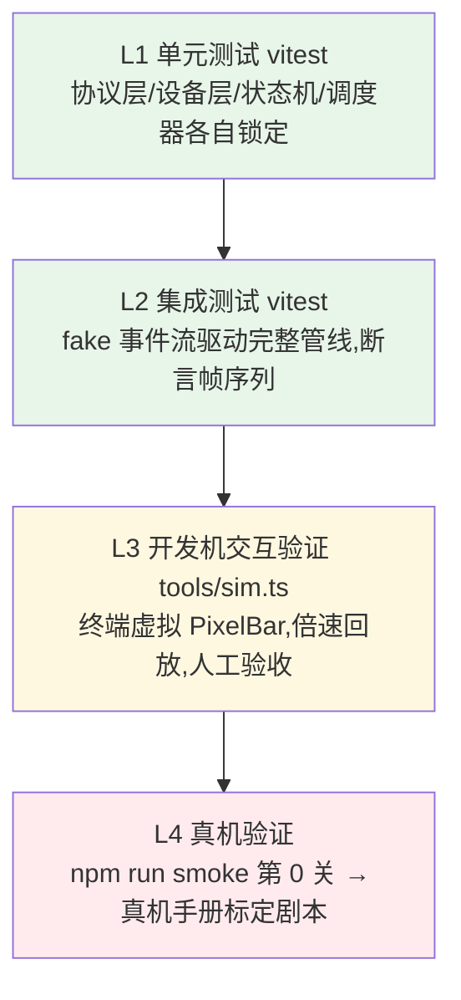

# 开发机测试设计（无硬件验证）

> 定位：开发机没有 PixelBar 时，如何完整验证"事件 → 归一化 → 聚合 → 调度 → HID 帧输出"全链。
> 上游：灯效映射.md（聚合时序推演 6 场景表）、DECISIONS D08（文字策略）/ D09（显示节律）、详细设计.md §6。
> L4 真机验证清单见 详细设计.md §7（PB.04）。

## 1. 测试分层



| 层 | 环境 | 进 CI | 验证什么 |
|---|---|---|---|
| L1/L2 | vitest + 替身 | ✅ 每次 commit | 行为正确性（帧序列逐帧断言） |
| L3 | `npm run demo -- --case <TC>` | ❌ 人工触发 | 观感/时序节奏/文字可读性（人眼验收） |
| L4 | 真机：`npm run smoke`（HID 直连）+ 真实 opencode | ❌ 人工触发 | HID 兼容性、协议假设、真实事件形态 |

## 2. 可测性设计要求（PB.02/PB.03 实现的强制约束）

无硬件可测的前提是**三个注入点**（DIP），实现状态机与调度器时必须遵守：

| 注入点 | 接口形态 | 为什么 |
|---|---|---|
| 时钟 | `now(): number` 注入（默认 `Date.now`） | 60s 重复窗口、10s 窗口、10min 过期不能真等——L2 用 vitest fake timers / 手动假时钟，L3 用倍速 |
| 事件源 | 事件迭代器注入（默认接 `ctx.event.subscribe`） | FakeEventBus 按时间轴脚本回放事件 |
| HID 传输 | `HidTransport` 注入（默认 node-hid，已有） | MockTransport 捕获全部帧供断言/回放 |

## 3. 测试资产

| 资产 | 职责 | 状态 |
|---|---|---|
| `MockTransport` | 捕获帧 + 可编程延迟/故障/响应 | ✅ 已有（PB.01） |
| `FakeEventBus` | 按 `[{delayMs, event}]` 时间轴注入事件（宿主形态优先，归一化也一并验证） | ⬜ PB.02 |
| `VirtualPixelBar` | 帧流解码器：`0x6B`→灯区名+参数、`0xE8`→文本、`0xEF`→模式；输出带时间戳的人可读时序行 | ⬜ PB.02 |
| 用例库 | 本文档 §4 的 TC 矩阵，vitest 参数化实现（TC 编号=测试名） | ⬜ PB.02/03 |

**期望帧序列记号**（测试断言与 sim 输出共用一套语义记号，测试内翻译为字节断言）：

```
MOOD  <灯区名>(r,g,b,bri,speed)   —— 0x6B 灯效帧（三连发=同帧×3）
TEXT  "<utf8 文本>"                —— 0xE8 文本帧
PIXEL static|scroll|clock          —— 0xEF 模式帧
—      （无帧：去重跳过/窗口静默）
```

## 4. 开发机可执行用例矩阵

> **v0.1.1（D13）矩阵更新**：新增 TC-A0（started 即亮流光）/TC-A7（打断回默认）；TC-A1/A6/B1/B5 改为"working 零 TEXT 帧"断言；TC-A2/C2 并入 A1（working 无文字后节流场景不复存在）；TC-D2 语义更新（compose 双预算后通知文字恒 ≤16 字符静态显示，滚动模式 v0.1 实际不触发，留真机标定 §7.7）；TC-A3/A4/A5/B2/B3/B4 别名全部改为项目名基准。

> **v0.1.2（D16，真机实测）矩阵更新**：设备停推 0xE8 后不会自动恢复默认显示（旧文字永驻）→ 所有文字窗口结束/文字熄灭处新增一帧 `PIXEL clock` 清屏断言；TC-C1 语义改为"到期只有一帧清屏，其余区间零帧"；TC-A1 保持 working 无文字，若此前有残留文字则补清屏帧。

> **v0.1.3（OpenCode 2.x 实测）矩阵更新**：新增 TC-D6（标题别名：session.created/注册标题 → 完成文字用标题）与 TC-E5（隐藏子会话 parentID 事件全忽略，零帧/零通知）；`npm run smoke:scroll` 为长文本滚动的用户侧目视实验（机器不可判）。

> **v0.1.4（D18，用户反馈）矩阵更新**：**60s 重复仅保留给 waiting（等待决策）**；done/error 只显示一次 10s 窗口后清屏——TC-A5、TC-B7、TC-C3 期望更新（去掉 60s 重复窗口）。

> 时间轴：`t=N 事件`；期望列只列**关键断言点**（灯效三连发计作一帧组）。全部 L2 可执行；标 ⭐ 的兼作 L3 演示用例。

### A. 单会话生命周期

| TC | 注入时间轴 | 期望帧序列（关键点） |
|---|---|---|
| ⭐TC-A1 working 无文字 | t=0 `session.execution.started` | 仅 `MOOD flow`，**零 TEXT/PIXEL 帧**（D13）；若此前屏上有残留通知 → 一帧 `PIXEL clock` 清屏（D16） |
| TC-A2 窗口内节流合并 | t=0、t=2、t=2.5 三次 `permission.asked`（不同会话） | TEXT 帧 @t=0；窗口内文字变化刷新走 1s trailing；MOOD 仅 1 次 |
| ⭐TC-A3 完成庆祝 | `tool.started` → `session.idle` | `MOOD ripple` + `TEXT "别名 完成"`；t+5s `MOOD breathing`（涟漪转呼吸）；`user.active` 后无新帧（队列清） |
| ⭐TC-A4 等批准全流程 | `permission.asked` → 70s 后 `permission.resolved` | `MOOD shadow` + `PIXEL static` + `TEXT "待批准"`；t=10s **一帧 `PIXEL clock` 清屏**；t=60s 重复窗口再发；resolved → `MOOD flow` 浮出 + 清屏（working 无文字） |
| TC-A5 会话失败驻留 | `session.failed` → t=65s `tool.started`（该会话新事件） | `MOOD solid(红)` + `TEXT "出错了"`；**只显示一次**（D18，无 60s 重复）；t=10s 清屏；新事件 → `MOOD flow` 回落（D09 解决信号） |
| TC-A6 工具失败不红灯 | 工具执行失败但会话继续（无 `session.failed`） | 全程灯效**保持 flow**，无 solid 帧 |

### B. 多会话并发（对齐 light-maps 场景表）

| TC | 注入时间轴 | 期望帧序列 |
|---|---|---|
| ⭐TC-B1 3s 双会话 working | S1 t=0 `tool.started(A)`；S2 t=2 `tool.started(B)` | `MOOD flow` + TEXT @t=0；t=2 **MOOD 无新帧**（去重）+ TEXT "Edit B.tsx"（最近活跃） |
| ⭐TC-B2 waiting 抢占与浮出 | S1 working → S2 `permission.asked` → S2 `resolved` | 立即 `MOOD shadow` 抢占 + "S2别名 待批准"；resolved → `MOOD flow` 浮出 + S1 工具文字重开窗 |
| TC-B3 双等待计数 | S1 `asked` → S2 `asked` → S1 `resolved` | TEXT `待批准` → 窗口内刷新 `2个待批准` → S1 解决后 `待批准` |
| TC-B4 error 压制浮出 | S1 `failed` → S2 `asked` → S2 `resolved` | 显示 waiting（MOOD shadow+待批准）；S2 解决 → **红灯浮出** `MOOD solid` + "S1别名 出错" 开窗 |
| TC-B5 done 不抢占 working | S1 `idle`（完成）→ S2 仍 working → S2 `idle` | S1 完成期间**保持 flow 无 done 帧**；S2 结束 → `MOOD ripple` + 轮播窗口接管 |
| ⭐TC-B6 离开归来轮播 | S1、S2 先后 `idle` → `user.active` | 涟漪 5s → 呼吸；轮播窗口 `S1别名 完成`（3s）→ `S2别名 完成`（3s）；`user.active` → 队列清，无新帧 |
| TC-B7 done 不重复 | 3 个会话 `idle`，无 `user.active` | 首窗轮播条目 1–3（10s 内）；**不 60s 重播**（D18），done 灯效保持到 user.active 或条目 10min 过期 |

### C. 显示节律（D09）

| TC | 注入时间轴 | 期望 |
|---|---|---|
| TC-C1 窗口到期即清屏 | TC-A4 基础上检查 t=10s–60s 区间 | 到期时刻**仅一帧 `PIXEL clock` 清屏**，其余区间零 TEXT/PIXEL 帧（D16） |
| TC-C2 working 无重复 | 一次 `tool.started` 后 120s 无事件 | 仅 1 个文字窗口（t=0–10s），**无 60s 重复** |
| TC-C3 done 条目过期 | 完成 1 条 → 假时钟 +11min，无 `user.active` | 队列自动清 → 聚合回 idle，`MOOD breathing`；轮播窗口不再开 |
| TC-C4 每次完成触发涟漪 | done 显示期间另一会话又 `idle` | 再发 `MOOD ripple` 一次（5s 计时重置）；若当时正显示更高状态则不发 |

### D. 文字规格（D08）

| TC | 注入 | 期望 |
|---|---|---|
| TC-D1 basename 浓缩 | 深路径 `a/b/c/d/VeryDeep.tsx` | TEXT 仅含 `VeryDeep.tsx` 前缀（总长超限时照滚动） |
| TC-D2 滚动模式 | 17 字符组合文字 | 先 `PIXEL scroll` 帧后 TEXT 帧 |
| TC-D3 字节安全截断 | 超长 title（>48B）完成轮播 | TEXT ≤48B；**尾部完整保留 "完成"**；不出现半个 UTF-8 字符 |
| TC-D4 序号兜底 | 无 title 会话完成 | TEXT `S1 完成` |
| TC-D5 别名正常拼接 | title="修复登录页CSS" 完成 | TEXT `修复登录页CSS 完成`，无滚动帧（11 字符） |
| TC-D6 标题别名落地 | `session.created {title:"状态灯插件"}` → 完成 | TEXT `状态灯插件 完成`（title 优先于项目名；v0.1.3） |

### E. 降级与健壮性（全链）

| TC | 注入 | 期望 |
|---|---|---|
| TC-E1 全程无设备 | DeviceHolder 恒 null，正常事件流 | 全部事件处理**零 crash、零帧输出**；控制台无未捕获异常 |
| TC-E5 隐藏子会话隔离 | `session.created {parentID:"root"}` → child 的 started/completed | **零帧**：不进 working、不进完成队列（防幽灵「完成」；v0.1.3） |
| TC-E2 中途 fatal | 运行 5s 后 write 失败×3 | 该次输出静默放弃；状态机/调度器继续运行不抛；60s 后 holder 重开尝试（期间 lazy get 返回 null） |
| TC-E3 冷启动已活跃 | 启动时已存在 working 会话 | 事件流注入起始快照（PB.02 实测 session.list 形态后落具体断言） |
| TC-E4 中断 vs 完成 | Esc 中断产生的 idle（形态待 PB.02 实测） | 实测后补断言：可区分则映射 error，不可区分则按完成处理并记录 |

## 5. L3 演示工具（tools/sim.ts）

```sh
npm run demo -- --case TC-B2        # 单用例倍速回放
npm run demo -- --suite B --speed 6 # B 组全部，6 倍速
```

- 驱动：FakeEventBus 按用例时间轴（经倍速压缩）注入 → 完整真实管线（非 mock 状态机）→ MockTransport 捕获 → VirtualPixelBar 终端输出
- 输出形如：`[+2.0s] MOOD  shadow(0,0,0,100,255)×3`、`[+2.0s] PIXEL static`、`[+2.0s] TEXT  "修复登录页CSS 待批准"`、`[+10.0s] PIXEL clock  （D16 清屏）`
- 灯区用 ANSI 色块示意（flow=青、shadow=紫、solid红=红、ripple=彩、breathing=暗青），人工观感验收

## 5.1 L4 入口：真机冒烟脚本（scripts/device-smoke.ts）

```sh
npm run smoke                      # probe → open → moods → text（~25s）
npm run smoke -- --stage probe     # 只枚举，不开设备
npm run smoke -- --stage open      # 开设备 + 0x6A 原值（--no-restore 保持灯态）
npm run smoke -- --stage scroll    # D11 实验：>16 字符绕过护栏直发
npm run smoke:scroll               # 同上，显示 15 秒（用户目视：滚动/截断/无反应）
```

- **机器可判项**：node-hid v3 形状、VID/PID 发现、候选排序（0xFF14 → interface 4）、设备打开、0x6A 可解析、写失败告警、设备回声计数
- **目视项**（脚本末尾列出）：五种灯效是否实际变化、文字 10s 显示与自愈
- 输出结构化（分段表 + `--json` 摘要），退出码 0/1/2；不进 CI（需要真机），是 `docs/真机手册.md` 第 0 关的机械化版本
- 真机实测基线（2026-11-16）：`arrayIndex=32`、0x6B 逐条回声（三连发 → 3 条）、`currentIndex`/group RGB 可复核设置是否生效

## 6. 与 CI 的关系

- L1/L2 全部进 `npm test`（每次 commit，铁律：先测后交）
- TC-R/TC-C3 等长周期用例经**时钟注入**实现，测试实际耗时 <100ms/条
- L3 不进 CI（需要人眼）；`npm run demo` 仅开发机
- 本文档用例矩阵与 light-maps 场景表、D09 链路一一对应——规格变更时三处同步

## 7. v0.2 dsh 适配用例（TC-DA 系列，2026-11-17 设计稿，PB.21/PB.22 实施）

> 全部 L1/L2：mock ctx（`on` 记录器 + 手动触发回调），**不依赖真实 dsh/cordis 包**，进 CI。payload 形态按 dsh调研.md §6.2 默认假设编写，PB.23 标定后如有出入同步修订期望。

### 7.1 事件归一 `normalizeDshEvent` / `attachDshEvents`（events/dsh.test.ts）

| 用例 | 输入 | 期望 |
|---|---|---|
| TC-DA1 | 12 通道各发一典型 payload | 各产出 §10.3 表对应 InternalEvent（类型+sessionID 字段） |
| TC-DA2 | `approval/request` listener 以多种 payload（正常/畸形/抛错 payload）触发 | **每次 next() 恰调用一次、返回值透传**；normalize 失败不影响转发 |
| TC-DA3 | payload 携带 creator 非空（子 Agent） | 产出 []（不聚合，D17 对应物） |
| TC-DA4 | 缺字段/畸形 payload（null、数字、空对象） | 返回 []，**绝不抛异常**（铁律 1） |
| TC-DA5 | attachDshEvents(mock ctx, emit) | 注册通道清单 = §10.3 表 12 项；disposer 调用后 emit 不再被触发 |
| TC-DA6 | session/created（含 title）→ agent/created → agent/session-start 幂等双发 | 台账 1 条；title 播种；session.started 幂等不重复触发 working 通知 |
| TC-DA7 | agent/request-error | session.failed → error 红灯路径（复用 states 断言） |
| TC-DA8 | agent/turn-stopping 无前置 error | session.completed → done 轮播（复用 TC-B 系列） |
| TC-DA9 | agent/disposed：a) 未见终态 → session.abandoned；b) 已见 turn-stopping → 无事件；c) 已见 request-error → 无事件（防误清红灯） | 打断兜底 R2 的 Phase 1 形态；PB.23 标定后复核 |
| TC-DA10 | agent/inbox/claimed | user.active → 完成队列清空 |
| TC-DA11 | attachDshEvents 第三参 onRaw：raw 先于 emit 收到 (channel, args)；onRaw 抛异常不断 emit 主链（观察口独立兜底） | PB.22 新增（raw 留痕/JSONL dump 的通道语义） |

### 7.2 入口 `src/dsh-entry.ts`（dsh-entry.test.ts）

> 实施注记（2026-11-17）：apply 为薄壳，实际逻辑在 `startPixelbar(ctx, hooks?)`（hooks = 测试注入口：openDevice/clock）；配置读取兼容「scoped 配置块 / 扁平 config」双形态（📌 PB.23 收敛）。

| 用例 | 输入 | 期望 |
|---|---|---|
| TC-DB1 | startPixelbar(mock ctx + MockTransport)，触发 agent/session-start | 装配五件套起转：MockTransport 收到 idle 呼吸帧 → working 灯效帧；12 通道注册 + 1 个 Effect 登记 |
| TC-DB2 | apply 时 ctx.on 每通道注册即抛 | 静默降级：不抛出宿主、diag 留痕（monitor /state 验证，端口 18795）、零订阅（monitor 面板仍镜像 idle 呼吸——"无帧"指设备侧，dev/CI 无真机即无设备帧） |
| TC-DB3 | ctx.effect 登记的 disposer，调用之 | 通道注销（宿主 disposer 执行）+ 标志位兜底：再触发已捕获的 listener 引用不产生新帧 |
| TC-DB4 | enabled: false（scoped 与扁平两种配置形态各跑一次） | 空转：零订阅、零托管、零上电 |
| TC-DB5 | 模块导出 | `name` 字符串 + `apply`/`startPixelbar` 函数形状；零 cordis import（编译期断言：`npm run lint` 通过即证） |

### 7.3 与既有矩阵关系

- states/effects/hid 全部既有用例（126 条）**零改动**——dsh 面只新增映射层用例；
- PB.23 标定后：TC-DA 系列期望按实测 payload 修订 + 灯效映射.md 增 dsh 事件列（三处同步纪律）。

