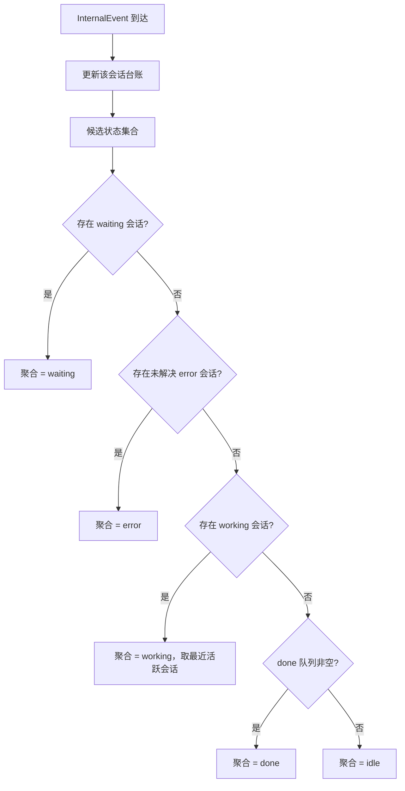
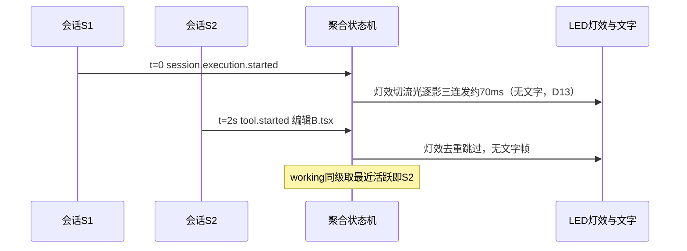
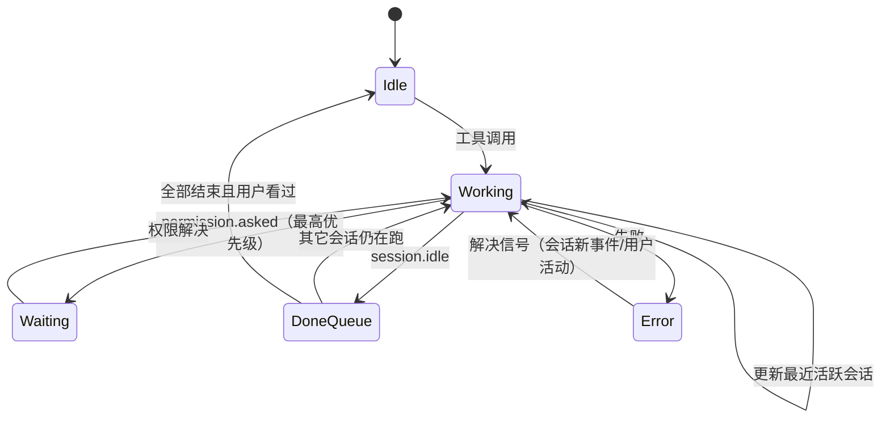

# 状态 → 灯效映射规格（多会话聚合）

> 设计定稿 2026-11-16（用户批准）；对应实现 `src/lights/states.ts`。
> **变更 2026-11-16（用户批准，DECISIONS D06）**：v0.1 保留多会话聚合核心（优先级压缩 + 完成队列轮播），砍边缘特性推迟 v0.2——待报呼吸"略亮"区分、working 文字会话名前缀、会话标题复杂兜底。
> **变更 2026-11-16（用户批准，DECISIONS D08）**：LED 文字策略改版——去全部颜文字，状态词明确化（待批准/执行出错/完成）；浓缩规则式否决本地 LLM；会话别名 = title 原文不截断（超长滚动）+ 序号兜底。
> **变更 2026-11-18（v0.3 后台工作追踪）**：opencode 侧完成信号语义细化——轮次结束（execution.succeeded）但该会话仍有活跃后台 shell（background:true 脚本）时，**completed 被抑制**（灯效保持 working 流光，working 态无衰减）；最后一个 shell 退出后 3s 宽限期内若无宿主通知唤醒（execution.started），补发 completed（涟漪+完成）；唤醒则取消补发（防"完成涟漪→working"闪烁）；打断（interrupted）撤销抑制不补发（D13）。事件依据：shell.created data=`{info:{id,metadata:{sessionID}}}`（归因）+ shell.exited/deleted data=`{id}`（配对回收），持久化日志 2026-11-18 实测。

> **变更 2026-11-17（v0.2 dsh 宿主接入）**：显示模型/状态机/节律全部不变；新增 dsh 事件源——dsh 通道 → InternalEvent 映射见**详细设计 §10.3 实测定稿**（核心：`session/event` 为权威信号源，turn/start|end、step/*、tool/*、审批审计对 approval/asked|decided 全部走 durable 通道；实测四状态：working/待批准/完成/空闲全链目击）。dsh 侧会话别名自 2026-11-22（PB.32）起接真实页签名：`session/title` → `session.renamed` → 台账 title；标题晚于 `turn/end` 到达时回写已完成条目，不再锁死 `S1 完成`。

> **变更 2026-11-22（PB.33 标题跨轮次持久化）**：标题不再随 `session.completed` 删台账而丢——引擎维护独立标题缓存（上限 512，LRU 淘汰），`session.renamed` 无论会话是否仍在台账/完成队列都写入；dsh 侧 `turn/start|end` 额外经 `ctx.sessionTitle.get()` 动态兜底（重启后旧会话的 log-only `session/title` 不补发）。

> **变更 2026-11-22（PB.34b 宽度实测）**：文字限制从“16 字符”修正为**48 UTF-8 字节硬限 + 256px 屏宽**（中文≈16px、ASCII≈9px）。`pixelbar-one-look 完成`（24B/194px）可完整静态显示；宽度超出默认 0xEF 滚动、不再按字符截断；字节超出 48B 仍截断（设备硬限）。

> **变更 2026-11-16（用户批准，DECISIONS D09）**：显示模型升级三层通道——灯效持续到状态解决（error 推翻 10s 回落）、文字 10s 窗口 × 60s 周期、静默期设备自动回默认显示（时钟/动图）；working 文字事件驱动窗口、无重复。
> **变更 2026-11-16（用户批准，DECISIONS D13）**：①working 态取消文字（文字通道专注通知：待批准/出错/完成；文件名/命令在 16 字符屏上是噪音）；②别名=项目名（location 目录 basename，替代 S 序号）→ **R3 增补：GUI 页签重命名（session.renamed）优先级最高**；③`session.execution.started` 即亮流光（思考阶段不空窗）；④打断→回默认显示（不庆祝不通知）。
> **变更 2026-11-16（真机实测，DECISIONS D16）**：设备停推 0xE8 后**不会**自动恢复默认显示（旧文字永驻）；文字窗口结束/文字熄灭时由插件发一帧 `0xEF 时钟` 清屏。
> **变更 2026-11-16（v0.1.2 宿主实测）**：OpenCode Desktop 2.x（实测 2.3.0）事件流生效；完成别名统一为 title→project→S（此前 done 路径强制项目名）；隐藏子会话（`session.created.parentID`）不参与聚合。
> **变更 2026-11-16（D18，用户反馈）**：**60s 重复机制只保留给 waiting（等待决策）**；done/error 只显示一次 10s 文字后清屏——完成不需要决策，反复提醒属打扰。
> D39 语义移植（前身项目实测标定）。

## 优先级压缩（一个物理屏，N 个会话）

**规则：永远显示"最需要你行动的"**

```
① 等权限（permission 待决）    ← 阻塞 Agent，需要你操作
② 失败（10s 驻留后回落）        ← 需要你知道
③ 执行中（工具调用）            ← 背景信息，最近活跃者优先
④ 完成待报（队列轮播）          ← 离开期间积攒
⑤ 空闲
```

同优先级多会话 → 取最近活跃（按最后事件时间）；灯效相同所以显示哪个无差别。

## 状态→输出映射表

| 聚合状态 | 灯效（0x6B） | 文字（0xE8） | 显示节律（D09） |
|---|---|---|---|
| idle 空闲 | 灯区 1 呼吸（默认色）| （无推送）| 不推送文字；若屏上残留通知文字 → 发 0xEF 时钟帧清屏（D16）|
| working 执行中 | 灯区 5 流光逐影 | （无文字——灯效表达执行态，D13 用户反馈修订）| 灯效持续；`session.execution.started` 即亮（思考阶段不空窗）|
| waiting 等权限 | 灯区 6 动态光影 | 单个：`待批准`；多个：`N个待批准`；可带别名前缀 `别名 待批准` | 灯效持续到解决；文字 10s 窗口 × 60s 周期（D09）|
| error 失败 | 灯区 3 纯色红 | `执行出错`；带别名：`别名 出错` | 灯效驻留到**解决信号**（该会话新事件或用户活动任一，D09）；文字 **10s 单次**（D18，不重复）|
| done 完成待报 | 灯区 4 炫彩涟漪 5s → 灯区 1 呼吸（v0.1 与空闲同参数）| 庆祝文字 `完成`；**轮播队列**：每完成条目 3s，`别名 完成`（title→project→S） | 灯效涟漪 5s→呼吸；文字 **10s 单次**（D18，不重复）；解决=用户操作或条目 10min 过期（D09）|
| 中断（手动打断/超时/被取代） | 回 idle（呼吸+默认显示）| **无**——打断时用户在场，不庆祝不通知（D13）| `session.execution.interrupted` → 会话移除回默认 |

## LED 文字规格

- 双线规则（PB.34b 实测校准）：**48 UTF-8 字节是设备硬线**（拼接后整体计算）→ 别名按字节安全截断、状态词完整保留；**256px 是屏宽排版线**（中文≈16px、ASCII≈9px）→ 宽度超出**默认走 0xEF 滚动**承载全文，不再按 16 字符截断。16 字符只是全角近似值，已废弃。
- 权威详解与场景示例：DECISIONS.md D08「策略详解」
- 会话别名 = title（`session.created`/`session.renamed` 事件 + 冷启动 `ctx.session.list()` 播种；dsh 另接 log-only `session/title`，PB.32）→ 项目名 → S 序号（v0.1.2；完成路径同样适用）；标题存独立缓存（PB.33），完成删台账不丢，dsh turn 边界再动态兜底；预算只按 48B 字节算（PB.34b），宽度交给调度层静态/滚动判定
- **状态词明确化（D08，替代颜文字）**：`待批准` / `N个待批准` / `执行出错` / `完成` / `执行中`（保底）——文字层职责 = 身份（别名）+ 状态细节；灯效层职责 = 状态类别
- working 细节 = 工具名 + 文件 basename（规则式浓缩：`src/components/Login.tsx` → `Login.tsx`；超长走滚动；提取失败 fallback `执行中`）

## 显示节律（D09：三层通道）

| 通道 | 载体 | 行为 |
|---|---|---|
| 灯效 | 0x6B | 持续显示聚合状态，解决后回落 |
| 文字通知 | 0xE8/0xEF | 10s 窗口；**仅 waiting** 未解决每 60s 周期重复（done/error 单次，D18；working 无窗口）|
| 默认显示 | 设备原生 | 窗口结束由插件发一帧 `0xEF 时钟` 清屏（**D16 真机实测：停推后设备不会自动恢复**）|

- 周期从窗口开启时刻起算（10s 显示 + 50s 静默）
- 完整决策链路（状态×通道×解决信号总表 + 流程图）：DECISIONS.md D09「决策链路」

## 聚合时序推演（并发场景详解）

> 机制核心：**每个事件到达即时重算聚合**——更新台账 → 取候选状态集最高优先级 → 与当前显示比对（灯效去重/文字刷新）。没有显示排队，只有优先级压制。

### 聚合决策瀑布（每个事件驱动一次）



### 并发场景推演示例：3s 内两个会话先后报事件



### 并发场景总表

| 并发场景 | 灯效 | 文字 | 台账后续 |
|---|---|---|---|
| 3s 内 S1、S2 先后 tool.started | 流光逐影（去重不重发）| 窗口内刷新为 S2 工具名（最近活跃）| 两会话均 working |
| S1 working + S2 permission.asked | **立即切**动态光影（抢占）| 开窗 `别名 待批准` | S1 被压制；S2 解决后 S1 浮出恢复 |
| S1 waiting + S2 waiting | 动态光影（不变）| 窗口内刷新 `2个待批准` | count 计数 |
| S1 error + S2 waiting | 显示 waiting（优先级高）| `待批准` | error 驻留候选集，waiting 解决后红灯浮出 |
| S1 完成 + S2 仍在 working | 保持流光逐影 | 不开 done 窗（不抢占）| done 队列暂存，S2 结束后 done 接管显示 |
| S1、S2 先后完成 | 涟漪 5s → 呼吸 | 窗口内轮播 `别名A 完成`、`别名B 完成`（每条 3s）| 只显示一个 10s 窗口，不 60s 重播（D18）；user.active 清队 |

### 压制与浮出语义（D09 延伸）

- **驻留 ≠ 持续显示**：error/waiting 等状态的"驻留"指在候选集合中保持，直到解决信号；显示层随时可能被更高优先级状态压制。
- **压制解除即浮出**：高优先级状态解决 → 即时重算 → 次高未解决状态自动浮出（如 waiting 解决后 error 红灯接管）。
- **浮出即开窗**：被压制状态浮出时按新状态开 10s 文字窗口（不是恢复旧窗口）。

## 完成事件队列（多会话陆续完成的核心）

```
完成 → 入队 {sessionTitle, ts}
灯效：庆祝涟漪 5s → 呼吸（醒于空闲）
文字：10s 窗口内每条 3s 轮播（指针跨窗口保持）；done/error 单次窗口，仅 waiting 未解决每 60s 重开（D09/D18）
清除：① 收到任何用户输入事件（用户已在看 opencode）② 每条存活上限 10 分钟
```

## 状态机



## 红线

1. 插件内存聚合，HID 单写入流（单写者原则）
2. 灯效切换三连发（30ms 间隔）；文字 ≤1/s 合并节流
3. 通道分离（D09）：灯效持续到状态解决（waiting→批准；error→该会话新事件或用户活动；done→看过/过期），文字一律 10s 窗口节律；待报呼吸与空闲同参数（"略亮区分"推迟 v0.2）
4. 任何 HID 写失败静默重试/放弃，绝不抛进 opencode
