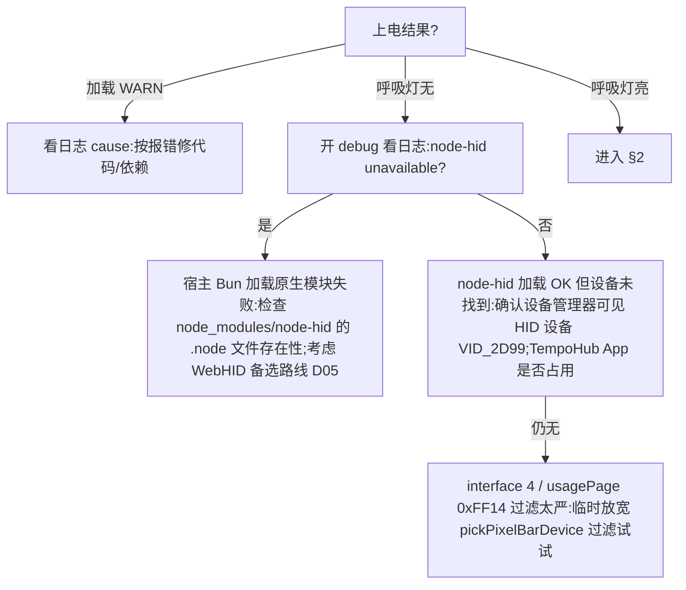
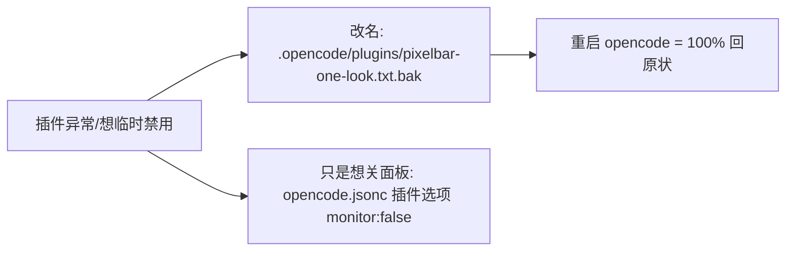

# 真机操作手册 — PixelBar 上电标定剧本

> 目标读者：带着 PixelBar 回家的你。全程照单打勾，30–60 分钟拿到完整标定记录。
> 上游：详细设计.md §7 标定清单；本手册是其"操作剧本化"版本。
> 约定：✅ 打勾通过；❌ 失败 → 走该步的"失败分支"；结果记入文末验收表。

## 0. 回家前的准备清单（有网就先做）

- [ ] 开发机（本机）`npm test` 120/120 绿（确认代码基线健康）
- [ ] PixelBar USB 线在包里
- [ ] Windows 装好 opencode Desktop 且本项目代码已 clone/pull 到家机
- [ ] 家机 `npm install`（node-hid 是 optionalDependency，装失败不阻塞但真机需要它——看 npm 输出有无 node-hid 警告，有则记录）

## 1. 上电冒烟（第 0 关：5 分钟）

> **机械化路径（推荐先跑）**：`npm run smoke`——不经 opencode 直连 HID，把发现/0x2E/0x6A/灯效/文字一次过完（约 25 秒，机器判定项全自动，目视项列在末尾）。脚本 PASS 后再做下面的插件全链冒烟。

### 1.0 脚本冒烟（`npm run smoke`）

```sh
npm run smoke                    # probe → open → moods → text
npm run smoke -- --stage probe   # 只枚举（不开设备，不改灯态）
npm run smoke -- --stage open    # 只开设备 + 0x6A 原值（--no-restore 保持灯态）
npm run smoke:scroll             # D11 长文本实验：显示 15 秒，请盯屏幕
```

预期（2026-11-16 本机实测基线，可对照）：

- probe：17 个 HID 设备中 3 个 PixelBar 节点；**候选顺序 0xFF14 → interface 4**
- open：`arrayIndex=32`；0x6A 应答含 7 组（index 1–7 = 灯效槽位）与 `currentIndex`
- moods：五效果各三连发，**15 条 0x6B 回声**（=5×3，设备逐条 ACK）；复核 `currentIndex` 变为最后发送的效果号（1 呼吸 / 5 流光 / 6 光影 / 3 纯色 / 4 涟漪）
- text：`PB冒烟 完成` 显示；**停推后设备不会自动恢复**（D16 实测），脚本默认在观察结束发 `0xEF 时钟` 清屏

**❌ 脚本失败分支**：

- `WriteFile: (0x00000001)`（ERROR_INVALID_FUNCTION）→ 打开了不可写 collection（0xFF13）。本脚本已按 0xFF14 优先 + 候选逐个试开修正；若仍出现，打印候选列表抓包对照
- `打开设备 + queryMood×3` 失败 → TempoHub App 先退出再试（独占占用）；仍失败按 §2.2 走
- `设备存在` 失败 → USB 连接/线缆/设备管理器 VID_2D99

### 1.1 插件全链冒烟

**操作**：PixelBar USB 连接 → 彻底重启 opencode（确认后台 server 进程退出再启动）→ 打开本项目会话发条消息。

**预期**：插件加载（宿主日志无 `failed to load plugin`）→ **灯条上出现空闲呼吸灯**（淡青色渐暗渐亮）→ 控制台 `http://127.0.0.1:18789` 可访问。

| 检查点 | 通过标准 |
|---|---|
| A. 插件加载 | 宿主日志 `~\.local\share\opencode\log\opencode.log` 无 WARN |
| B. 呼吸灯 | 灯条淡青呼吸（不亮/不变化也先别慌，走 C）|
| C. node-hid 加载 | 控制台 `logEvents/debug` 关着时看不到——**开 debug 快速确认**：`opencode.jsonc` 插件选项 `debug: true` 重启，日志搜 `[pixelbar]`，出现 `node-hid unavailable` 即加载失败 |

**❌ 失败分支**：



## 2. 标定剧本（9 项，按依赖顺序）

### 2.1 0x2E report ID 判定（D03 终验，全卡最重要的一关）

**操作**：`npm run smoke -- --stage open` 已隐含验证——0x6A 有应答即写入帧被设备接受。

- [x] ✅ **机器验证通过（2026-11-16 本机）**：0x6A 查询返回完整 payload、0x6B 设置后 0x6A 复核 `currentIndex`/RGB 变化、每条 0x6B 收到一条回声帧 → **0x2E 即 report ID（D03 结案，无需 0x00 前缀）**
- [ ] 呼吸灯目视确认（脚本复位后应回到淡青呼吸）
- [ ] ❌ 灯毫无反应但写入无报错 → 仅剩两种可能：report ID 不符（试 `Uint8Array.of(0, ...frame)`）或换机固件差异；抓包对照 TempoHub App（USBPcap）

### 2.2 arrayIndex 运行时查询（0x6A，D04 不猜值）

**操作**：`npm run smoke -- --stage open` 已执行（open → queryMood×3）。

- [x] ✅ **实测值（2026-11-16 本机）**：`arrayIndex=32 (0x20)`、`currentIndex=1`、7 组灯效槽位；**0x6A 空 payload 可用**（`MOOD_QUERY_PAYLOAD` 无需改）
- [x] ✅ 应答语义校准：groups 的 `index` 1–7 与 0x6B 灯区枚举一致（1 呼吸/2 潮汐/3 纯色/4 涟漪/5 流光/6 光影/7 总开关），各 slot 保存自己的 RGB/亮度/速度；`currentIndex` = 设备当前生效的效果号
- [x] ✅ 真机细节：每次 0x6B 写入设备**回一帧 0x6B 回声**（三连发 → 3 条），与 0x6A 应答同队列——`queryMood` 已改为跳过非 0x6A 帧
- [ ] ❌ 若你的机器 `arrayIndex` 非 32 → 属正常（固件差异），**以运行时查询值为准**，勿写死；查询失败仍按 D04 弃用设备

### 2.3 灯效四态观感（发消息即触发）

**操作**：发一条消息让 agent 跑起来，盯灯。

- [x] working：**流光逐影**动态流动，颜色观感 OK（2026-11-16 脚本 moods 阶段目视确认）
- [x] 完成后：**炫彩涟漪** 5 秒庆祝 → 转呼吸（涟漪目视确认；5s 转呼吸为 L2 断言，plugin 全链待跑）
- [ ] 观感问题微调：`src/lights/effects.ts` 的 `EFFECTS` 参数表（亮度/速度/RGB）——改完即热重载，方便现场调

> **场景化检查命令（用户自行运行）**：`npm run scenarios`（约 40s）依次演示空闲/执行/待批准/出错/完成/多会话抢占，结束自动清屏+回呼吸；建议在 opencode 空闲时跑，避免插件同时写设备。

### 2.4 文字通道（0xE8）

**操作**：让会话自然完成一次（done 轮播会推文字）。

- [x] 灯屏显示 **"PB冒烟 完成"**（脚本验证；会话名/项目名待插件全链）
- [x] 48B / 256px 内**静态居中**显示清晰
- [x] 窗口 10 秒后文字消失、回时钟——**由插件发 `0xEF 时钟` 清屏**（D16；2026-11-16 目视确认：实验结束回时钟）
- [x] 完成文字只显示一次（D18：完成不需要决策，无 60s 重复；60s 重发仅用于待批准）
- [x] 中文显示正常（无缺字方块）

### 2.5 长文本滚动（0xEF，观感决定 D11 去留）

**操作**：用一个长名项目（或长重命名会话）触发完成。

- [x] ✅ 实测（2026-11-22，PB.34b）：16 个中文完整；18 个中文（54B）只显示 16 个（48B 硬限）；40 位数字静态约 29 位；`pixelbar-one-look 完成`（20 字符 / 24B / 194px）**完整静态显示** → 真实约束 = **48B + 256px**（D26），16 字符只是全角近似
- [x] ✅ 试验：宽度 >256px 走 0xEF 滚动承载全文（不再按字符截断）；48B 以上仍截断（设备硬限）
- **数字化实验命令（PB.34）**：`npm run smoke:digits`（约 21s）——三段：16 位基线 / 40 位静态（绕过护栏）/ 40 位滚动；每段记录屏幕显示到第几位数字，结束自动清屏回呼吸。设备被插件占用报 busy 时，先在插件页停用 pixelbar 再跑。
- **中文宽度复测（PB.34b）**：`npm run smoke:cjk`（约 21s）——16 个中文数字（48B）/ 18 个中文数字（54B，绕过护栏）/ 真实混合标题 `pixelbar-one-look 完成`（20 字符/24B）；重点确认设备是按字符数还是按像素宽度排版，以及 ASCII 长标题能否完整显示。

### 2.6 权限批准通道（三场景之一）

**操作**：让 agent 执行一个需要批准的操作（比如写 opencode.jsonc 之类会触发 permission 的）。

> 选择/提问界面（`ask_user_question`）同样走等待灯效（PB.36）：提问期间动态光影 + `别名 待批准`，回答后回流光；与审批共用同一套映射。

- [ ] 灯切**动态光影** + 灯屏 "**会话名 待批准**"
- [ ] 批准后灯回流光逐影
- [ ] 面板 raw 流出现 `permission.asked` 事件（截图记录 data 形态，校准归一化假设）

### 2.7 失败通道（三场景之二）

**操作**：临时断网/给一个坏 API key，让一次 run 失败。

- [ ] 灯切**纯色红** + "**会话名 出错**"
- [ ] 文字只显示一次 10s（D18：不重复）；红灯常驻，agent 重新动起来后回落流光
- [ ] 面板 raw 流出现 `session.execution.failed`（记录 data.error 形态）

### 2.8 打断通道（三场景之三）

**操作**：在 agent 跑到一半时按 Esc 打断。

- [ ] 灯**直接回呼吸**（无涟漪无文字）——D13 语义
- [ ] 面板 raw 流出现 `session.execution.interrupted`（记录 data.reason 实际值）

### 2.9 多会话聚合真机观感

**操作**：两个会话并行（可以一个跑长任务一个触发权限）。

- [ ] 待批准正确抢占执行中；批准后回落
- [ ] 完成轮播在真屏上的节奏（3s/条）不晕不快

## 3. 验收记录表（逐项填结果，完成 = v0.1 真机 DoD）

| # | 标定项 | 结果（✅/❌/调整了什么） | 备注 |
|---|---|---|---|
| 0 | 上电冒烟 | ✅ 脚本路径 PASS（不经 opencode）；插件全链待跑 | 2026-11-16 本机首测 |
| 1 | 0x2E 判定 | ✅ 机器验证（0x6A 有应答 + 0x6B 回声 + 复核生效） | D03 结案，无需 0x00 前缀 |
| 2 | arrayIndex 查询 | ✅ `arrayIndex=32`、`currentIndex=1`、7 组槽位 | 0x6A 空 payload 可用（D04 落地） |
| 3 | 灯效四态观感 | ✅ 五效果目视确认（呼吸/流光/光影/纯红/涟漪） | 2026-11-16 慢速 3s/效果 |
| 4 | 文字通道 | ✅ 显示 + 中文 + 时钟帧清屏；D18 完成单次；⬜ 待批准 60s 重复待插件全链 | D16 实测：设备不自动恢复 |
| 5 | 长文本滚动 | | |
| 6 | 权限通道 | | |
| 7 | 失败通道 | | |
| 8 | 打断通道 | | |
| 9 | 多会话聚合 | | |

## 4. 万一插件出问题影响使用（恢复底线）



## 5. 标定完成后

- 结果回填本表 + DEVLOG（实测数字/观感参数调整记入）
- 若 0xEF 滚动实测支持长文本 → 开 v0.2 卡放开 compose 预算
- 全绿后：`git push`（真机调整可能产生参数修改 commit），npm publish 走 PB.05
