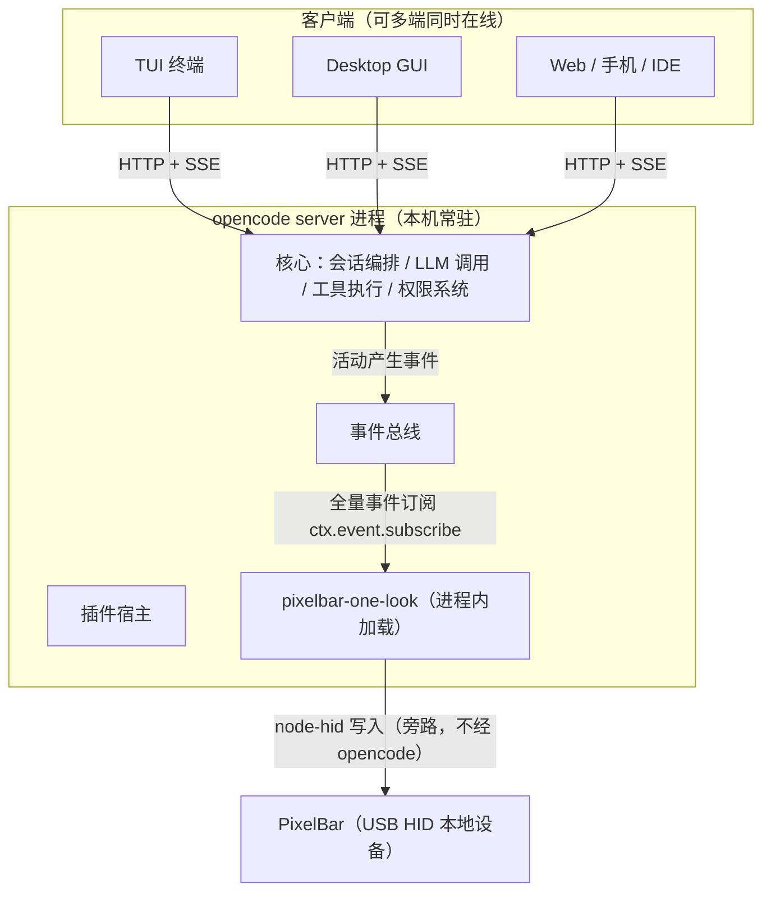
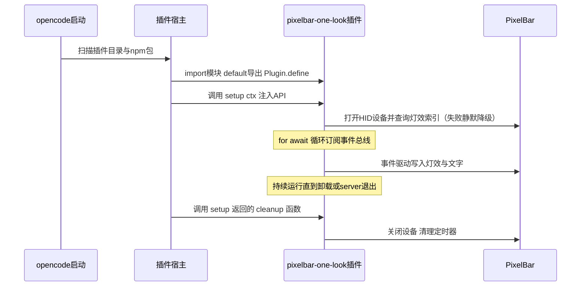
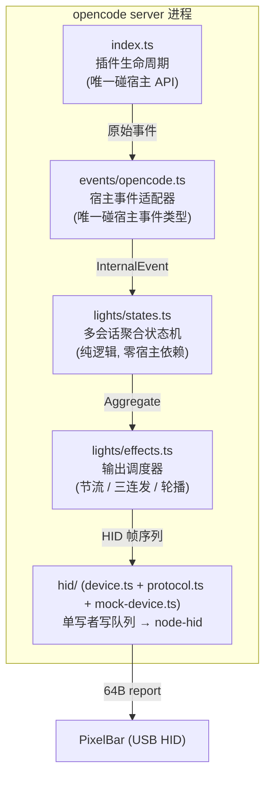
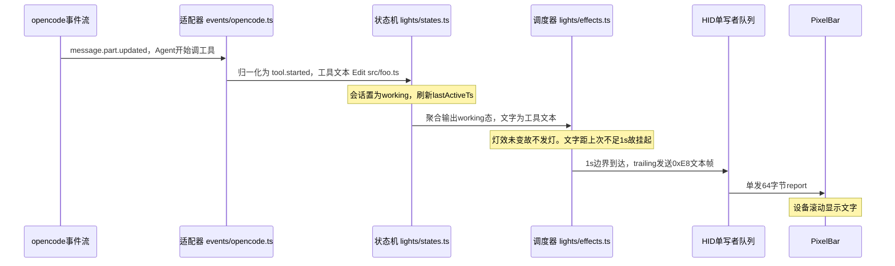
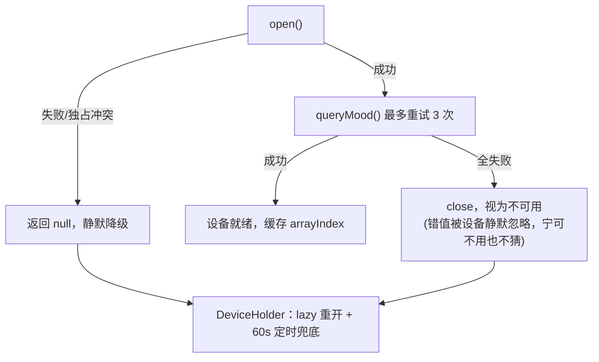
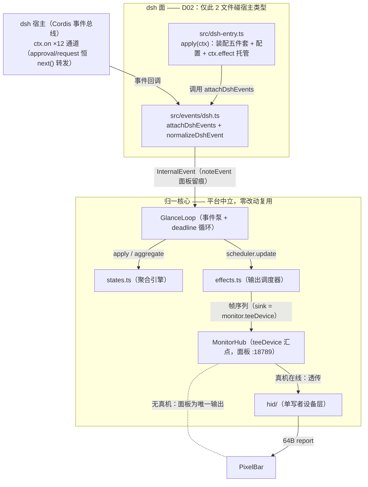

# pixelbar-one-look v0.1 详细设计

> 状态：**草案，待用户批准后进入实施**（对应 TASKS.md CARD.PB.01~04）。
> 上游规格：[协议.md](协议.md)（HID 协议唯一权威）、[灯效映射.md](灯效映射.md)（状态映射定稿）、[插件API调研.md](插件API调研.md)（宿主 API 调研）。
> 本文档回答"怎么实现"；"为什么这么设计"见 DECISIONS.md。

## 0. 宿主（opencode）机制与插件协同模型

> 本章回答三个前提问题：opencode 怎么运转？插件在哪个位置？为什么不需要改动 opencode 本体？

### 0.1 opencode 架构：server 与客户端的关系

opencode 是 **client-server 架构**。`opencode server` 进程常驻本机，承载全部核心逻辑——会话编排、LLM 调用、工具执行、权限审批；TUI / Desktop GUI / Web / IDE 客户端只是"视图"，经 HTTP API + SSE 事件流连接同一个 server。**一切 agent 活动都发生在 server 进程内**，与用户在哪个客户端操作无关。



关键推论：

| 问题 | 答案 |
|---|---|
| opencode 本身支持插件吗？ | **支持**——官方插件系统（`@opencode/plugin`），v2 内建，无需改造 |
| 需要修改 opencode 本体吗？ | **不需要**——零 fork / 零 patch / 零重编译，只用官方公开 API；安装=配置声明（`opencode plugin add` 或 `opencode.jsonc` 的 plugins 数组），卸载=移除 |
| 插件针对 GUI 吗？ | **不是**——跑在 server 进程，TUI / GUI / Web / IDE 全体通用；唯一约束：server 必须跑在插着 PixelBar 的电脑上（USB HID 是本地设备） |

### 0.2 插件生命周期（协同的五个阶段）



### 0.3 插件的能力边界（插件API调研.md 调研结论）

| 能拿到 | 用途 |
|---|---|
| `ctx.event.subscribe()` | 全量公共事件流（async iterator）——本插件唯一数据来源 |
| `ctx.session.list()` | 多会话台账兜底 |
| `ctx.permission.list()` | 等权限状态精确查询兜底 |
| `ctx.storage` / `ctx.options` | 配置持久化 / opencode.jsonc 传参 |

| 拿不到（按纪律主动不碰） | 理由 |
|---|---|
| 向 opencode 发送命令/消息/工具调用 | 架构铁律 2：纯消费、零反向注入 |
| 修改宿主行为/UI | 状态灯是旁路输出设备，不需要 |

插件对 opencode 的影响面=零：它只是事件总线上的一个订阅者 + 一个 USB 设备的写者。插件崩溃或异常也必须被内部吞掉（铁律 1），不允许影响宿主。

## 1. 总体架构

### 1.1 分层图



**数据流**：宿主事件 →（归一化）→ InternalEvent →（聚合）→ Aggregate →（调度）→ HID 帧序列。单向，无反馈注入。

### 1.2 跨平台隔离纪律（用户已批准）

| 纪律 | 落实 |
|---|---|
| 宿主类型只许出现在两个文件 | `src/index.ts`、`src/events/opencode.ts`；其余模块禁止 import 任何 `@opencode/*` 类型。**（v0.2 现状注记：扩为 4 个——dsh 面 `src/dsh-entry.ts`、`src/events/dsh.ts`，见 §10.2）** |
| 内部事件模型平台中立 | `src/events/types.ts` 定义 InternalEvent union，语义命名不照抄 opencode 事件名 |
| 核心不依赖宿主便利设施 | `ctx.storage`/`ctx.options` 仅在 index.ts 消化，以普通参数/接口注入核心 |
| 测试零宿主 | states/effects/hid 的单测不 import opencode 任何东西 |

未来支持 Claude Code/Gemini CLI 等 hook 型平台时：核心层零改动，新增 `daemon.ts`（复用状态机+输出+HID，监听 stdin/HTTP）+ hook 转发脚本。

### 1.3 一次典型输出的时序



## 2. 目录结构（src/）

```
src/
├── index.ts               # 插件入口：Plugin.define + 生命周期 + 选项消化
├── events/
│   ├── types.ts           # InternalEvent union（平台中立）
│   └── opencode.ts        # 宿主事件 → InternalEvent 适配器（含 debug 事件记录模式）
├── lights/
│   ├── states.ts          # 会话台账 + 聚合状态机（纯逻辑）
│   └── effects.ts         # 输出调度器：灯效切换/文字节流/轮播/定时器
└── hid/
    ├── protocol.ts        # 帧构造/CRC/payload builders/响应解析（纯函数，零依赖）
    ├── device.ts          # PixelBarDevice：发现/打开/单写者队列/三连发/queryMood/降级
    └── mock-device.ts     # MockTransport（测试/CI 零硬件）
```

各卡片归属：PB.01 = `hid/*`；PB.02 = `events/*` + `lights/states.ts`；PB.03 = `lights/effects.ts`；PB.04 = `index.ts` + 真机验证；PB.05 = 发布。

## 3. 核心数据模型

### 3.1 InternalEvent（`events/types.ts`，平台中立）

```ts
export type InternalEvent =
  | { type: 'permission.asked';    sessionID: string }
  | { type: 'permission.resolved'; sessionID: string }   // approve/deny 都算解决，deny 的失败由 session.failed 兜底
  | { type: 'tool.started';        sessionID: string; text: string }  // text=工具名/文件名，已提取
  | { type: 'session.completed';   sessionID: string }
  | { type: 'session.failed';      sessionID: string }
  | { type: 'user.active';         sessionID?: string }  // 任意用户输入（清完成队列）
```

映射草案（**PB.02 开工第一步实测校正**，见 §4.4）：

| opencode 事件（V2 schema 候选名） | → InternalEvent |
|---|---|
| `permission.updated`（出现待决项） | `permission.asked` |
| `permission.updated`（待决清空） | `permission.resolved` |
| `message.part.updated`（工具 part 开始） | `tool.started`（提取工具名/文件名） |
| `message.part.updated`（error part） | `session.failed` |
| `session.idle`（agent 本轮 run 结束，回到等待输入）| `session.completed` |
| 用户消息更新（role=user） | `user.active` |

**completed / failed 的语义定义**（v0.1 草案，PB.02 实测后定稿）：

- **completed** = `session.execution.succeeded`：agent 完成本轮 run（用户一次输入 → 多轮 LLM+工具循环 → 最终输出完毕），会话回到等待输入态——即"用户的一个输入得到的最终输出"。
- **failed（会话级，唯一触发红灯的层）** = 本轮 run 异常终止：LLM 调用失败、agent 崩溃。
- **abandoned（D13）** = `session.execution.interrupted`（reason=user/shutdown/superseded/inactivity）：会话移除、回默认显示——用户手动打断时人就在屏幕前，庆祝/通知均无价值。
- **working 即时启动（D13）** = `session.execution.started`（消息提交即发）→ 灯效立即切流光，不等第一个工具调用（思考阶段不空窗）。
- **working 态无文字（D13）**：灯效（流光逐影）表达执行态；文字通道专注通知（待批准/出错/完成）——过程细节（文件名/命令）在 16 字符屏上是噪音。
- **别名 = title → 项目名（D13/R3/v0.1.2）**：title（`session.created` / `session.renamed` 事件；opencode 冷启动由 `ctx.session.list()` 播种，dsh 冷启动由 `ctx.sessions.list()` + `ctx.sessionTitle.get()` 播种，且 dsh 侧 log-only `session/title` → `session.renamed`，PB.32）> 项目名（location 目录 basename）> 内部序号兜底；**完成轮播也走同一别名**（v0.1.2 修复：此前 done 路径强制项目名；PB.32 补完成队列晚到标题回写）；**标题独立缓存 + dsh turn 边界动态兜底**（PB.33：完成删台账不丢标题，重启后旧会话也能取回）。
- **隐藏子会话隔离（v0.1.2 实测）**：`session.created.parentID != null`（title/compaction 等内部会话）登记为子会话，其执行/完成事件不参与聚合——避免幽灵「完成」通知与状态抢占。
- **工具级失败不触发红灯**：单个工具出错（如 bash 非零退出）由 agent 自行处理/重试，会话仍在跑——灯保持 working 流光。不做此区分则红灯频繁误闪，状态灯不可用。

### 3.2 会话台账（`lights/states.ts` 内部）

```ts
interface SessionRecord {
  id: string
  title: string | null   // 显示别名首选；session.created/renamed + session.list 播种
  project: string | null // location 目录 basename（别名次选）
  parentID: string | null // 非空 = 隐藏子会话，不参与聚合
  status: 'working' | 'waiting' | 'error' | 'idle'
  lastActiveTs: number
  lastToolText: string | null
}
interface DoneEntry { sessionID: string; alias: string; ts: number }  // 完成轮播队列（别名=title→project→S）
```

### 3.3 Aggregate（状态机输出，纯数据）

```ts
export type Aggregate =
  | { kind: 'idle' }
  | { kind: 'working'; text: string }          // v0.1 仅工具文本；"[会话名]"前缀推迟 v0.2（D06） |
  | { kind: 'waiting'; count: number }        // 文字 待批准 / N个待批准（D08）
  | { kind: 'error'; text: string }           // 文字 执行出错（D08）
  | { kind: 'done'; entries: DoneEntry[] }    // 轮播队列快照
```

调度器只看 Aggregate，完全不知道会话/宿主的存在。

## 4. 模块详细设计

### 4.1 `hid/protocol.ts`（纯函数，PB.01）

常量：`VID=0x2D99`、`PIDS=[0xA106,0xA160]`、`CONTROL_INTERFACE=4`、`USAGE_PAGE=0xFF14`、`REPORT_SIZE=64`、payload 上限 57。

```ts
export const CMD = { MOOD_QUERY: 0x6A, MOOD_SET: 0x6B, MOOD_RESET: 0x72,
                     VOLUME_QUERY: 0x66, VOLUME_SET: 0x67,
                     TEXT_QUERY: 0xE7, TEXT_SET: 0xE8,
                     PIXEL_STATE: 0xEE, PIXEL_SET: 0xEF } as const

export const LIGHT = { BREATHING: 1, TIDE: 2, SOLID: 3, RIPPLE: 4,
                       FLOW: 5, SHADOW: 6, MASTER: 7 } as const

export function crc8(bytes: ArrayLike<number>, from = 0): number   // 求和 mod 256
export function buildFrame(cmd: number, payload: Uint8Array): Uint8Array
// [0x2E, 0xAA, 0xEC, cmd, lenHi, lenLo, ...payload, crc, ...零填充] → 恰 64 字节
// CRC 覆盖：0xAA 起(含)到 payload 末尾，即排除 report ID 0x2E（见 §5.0）
// payload>57 → throw

// ---- payload builders（输出与 协议.md 黄金样本逐字节一致）----
export function moodSetPayload(o: {
  arrayIndex: number; light: number;              // light ∈ LIGHT
  rgb: [number, number, number];
  brightness?: number;                           // 默认 100（厂商 UI 上限）
  speed?: number;                                // 默认 255=保持；呼吸/潮汐用 8
  mode?: number;                                 // 可选第 8 字节
}): Uint8Array
export function textSetPayload(text: string): Uint8Array
// [0x00, utf8Len, ...utf8]；硬限制：>48 UTF-8 字节 → throw；宽度由调度层判定滚动

// ---- 0xEF 像素设置（文本配套）----
export function pixelStaticPayload(o: { rgb; align: 0|1|2|3 }): Uint8Array  // 01 R G B 00 02 00 align FF
export function pixelScrollPayload(o: { rgb }): Uint8Array                   // 01 R G B 00 02 01 01 FF（宽度 >256px 滚动）
export function pixelClockPayload(o: { rgb }): Uint8Array                    // 01 R G B 00 01 00 00 FF
export function pixelThemePayload(o: { rgb }): Uint8Array                    // 03 R G B 00 00 FF FF FF

// ---- 设备响应解析 ----
export function parseDeviceFrame(frame: Uint8Array): { cmd: number; payload: Uint8Array } | null
// 校验 [0]==0x2F && [1]==0xBB；len 字段可信则截取，否则取到帧尾
export function parseMoodQueryPayload(payload: Uint8Array):
  { arrayIndex: number; currentIndex: number;
    groups: Array<{ index: number; rgb: [number,number,number]; brightness: number; speed: number }> } | null
// 组内 [index,R,G,B,亮度,speed]，每组 6 字节
```

**协议层错误策略**：纯函数越界直接 throw；由上层（device/effects）catch 后静默降级。分层清晰，测试可锁。

**黄金测试向量**（协议.md §0x6B，测试逐字节断言）：

```
breathing: [0x20,0x01,0x1C,0xFF,0xF8,0x64,0x08]   tide: [0x20,0x02,0x01,0x00,0x00,0x64,0x08]
solid:     [0x20,0x03,0x01,0x00,0x00,0x64,0xFF]   ripple:[0x20,0x04,0x00,0x00,0x00,0x64,0xFF]
flow:      [0x20,0x05,0x01,0x00,0x00,0x64,0xFF]   shadow:[0x20,0x06,0x00,0x00,0x00,0x64,0xFF]
solid红:   [0x20,0x03,0xFF,0x00,0x00,0x64,0xFF]
```

CRC 交叉验证三层：① 独立重写的求和函数对比 `crc8`；② 完整帧经 `parseDeviceFrame` 同构解析往返自洽；③ 手算常数向量写死断言（帧级样本见 §7 待补，PB.04 抓包可增补设备侧帧样本）。

### 4.2 `hid/device.ts`（PB.01）

**Transport 接口**（node-hid 与 Mock 的共同抽象，注入式）：

```ts
export interface HidTransport {
  write(data: Uint8Array): Promise<number>
  read(timeoutMs: number): Promise<Uint8Array | null>   // 超时返回 null，不阻塞事件循环
  close(): void
}
export interface DeviceLogger { warn(msg: string, err?: unknown): void; debug(msg: string): void }
```

node-hid 实现为薄包装：动态 `import("node-hid")`（见 §5.4），`devices()` 过滤 VID/PID 后按候选排序（**usagePage 0xFF14 优先，其次 interface 4**；真机实测 Col01(0xFF13) 不可写，D15），逐个 `new HID(path)` 试开到 queryMood 成功；write/readTimeout/close。**平台差异全部封在此文件一处**。

**PixelBarDevice**：

```ts
export class PixelBarDevice {
  static async open(logger: DeviceLogger): Promise<PixelBarDevice | null>
  // 发现失败/打开失败(独占冲突) → 返回 null，静默（红线：绝不抛进宿主）

  private enqueue<T>(task: (t: HidTransport) => Promise<T>): Promise<T>
  // 单写者核心：Promise 链串行化，全部 HID 写入经此队列

  async sendFrame(cmd: number, payload: Uint8Array): Promise<void>
  // 单发；写失败：logger.warn + 静默吞（不 reject 到上层）

  async sendFrameReliable(cmd: number, payload: Uint8Array): Promise<void>
  // 三连发：同一帧 ×3、间隔 30ms，作为队列内单个原子任务（灯效专用）

  async queryMood(timeoutMs = 500): Promise<MoodState | null>
  // 写 0x6A 查询帧 → read 等响应 → parseMoodQueryPayload → 取 arrayIndex

  get arrayIndex(): number | null
  close(): void
}
```

**打开流程**（红线 1：arrayIndex 必须运行时查询，禁写死）：



**DeviceHolder**（同文件；设备可用性的对外门面）：

```ts
export class DeviceHolder {
  constructor(open: () => Promise<PixelBarDevice|null>, logger)
  async get(): Promise<PixelBarDevice | null>   // 可用即返回；不可用则按策略尝试重开
  stop(): void
}
// 降级策略（§5.2）：写失败≥3 次或打开失败 → 标记不可用；
// 重开节奏 = lazy（下次有输出需求时）+ 60s 定时兜底，指数不升级，静默
```

### 4.3 `hid/mock-device.ts`（PB.01）

```ts
export class MockTransport implements HidTransport {
  writes: Uint8Array[]                // 记录全部写入（断言用）
  failNextWrites: number              // 可编程：接下来 N 次写入抛错（测降级）
  readQueue: Uint8Array[]             // 可编程响应队列（测 queryMood）
  writeDelays: number[]               // 可编程每笔延迟（测队列串行/三连发时序）
}
```

### 4.4 `events/opencode.ts`（PB.02）

归一化函数签名：**一个宿主事件 → 0..n 个 InternalEvent**（`message.part.updated` 流式更新需要压缩）。

```ts
export function normalize(opencodeEvent: unknown, ctx: { sessionTitle(id): string }): InternalEvent[]
```

**实测计划（PB.02 第一步，先于任何映射代码）**：插件选项 `logEvents: true` → index.ts 把原始事件按 JSONL 写到 `temp/events-<日期>.jsonl` → 真机跑一轮「权限批准/工具调用/完成/失败」→ 用脚本统计字段形态 → 校正 §3.1 映射表（事件类型全名以实测为准，插件API调研.md 已知 v2 命名可能微调）。

### 4.5 `lights/states.ts`（PB.02）

纯逻辑状态机，可被任何宿主驱动（跨平台纪律的落点）：

```ts
export class AggregationEngine {
  apply(event: InternalEvent, now: number): void
  // permission.asked → 会话 status=waiting（waiting 永不回落，红线 3）
  // tool.started → status=working，刷新 lastActiveTs/lastToolText
  // session.failed → status=error（灯效驻留到解决信号：该会话新事件或 user.active，D09）
  // session.completed → 会话移出台账，doneQueue 入队 {alias, ts}（alias=title→project→S，v0.1.2）
  // session.created → 登记 title/parentID（子会话后续事件全部忽略，v0.1.2）
  // permission.resolved → waiting 清除，回落 working/idle
  // user.active → doneQueue 清空（用户已在看 opencode）

  aggregate(now: number): Aggregate
  // 优先级压缩：waiting > error > working > done 队列非空 > idle（error 无时限，解决信号驱动，D09）
  // 同级取 lastActiveTs 最近；done 条目超 10 分钟出队

  nextDeadline(now: number): number | null
  // 返回最近需要"无事件也重算"的时刻：文字窗口 10s 到期 / waiting 60s 重复窗口 / 窗口内轮播切换 / done 条目过期（D09/D18）
}
```

文字组装（在 aggregate 内完成，调度器拿现成的）：

- working：**无文字**（D13 用户反馈修订——灯效表达执行态，文字通道专注通知）；`lastToolText` 仅维护最近活跃台账
- 中断/打断：`session.abandoned` → 会话移除回默认显示（不进完成队列，D13）
- waiting：`待批准`；多个等待 `N个待批准`；带别名时 `别名 待批准`（D08）
- error：`执行出错`；带别名时 `别名 出错`（D08）
- done 轮播：`别名 完成`（别名 = title → 项目名 → S 序号，v0.1.2 完成路径统一）；宽度 >256px 的完整名字走 `0xEF` 滚动（PB.34b 实测放开，不再按 16 字符截断）
- 全部经 `fitText()`：**48 UTF-8 字节是设备硬线**（**拼接后整体**计算，按字节安全截断、不切半个字符、状态词优先保留）；**256px 是屏宽**（中文≈16px、ASCII≈9px）→ 超宽标记滚动、由调度器走 0xEF 模式承载全文——权威详解与示例见 DECISIONS.md D08/D26「策略详解」

### 4.6 `lights/effects.ts`（PB.03）

```ts
export class OutputScheduler {
  constructor(device: () => Promise<PixelBarDevice|null>, logger)
  update(agg: Aggregate, now: number): void   // 每次事件后 + 每 deadline 到点时由 index.ts 调
  stop(): void                                // 清全部定时器，幂等
}
```

内部规则：

| 规则 | 实现 |
|---|---|
| 灯效切换去重 | `effectKey = light|rgb|brightness|speed`，与上次已发 key 相同则不发 |
| 灯效切换发送 | `sendFrameReliable`（三连发 30ms，队列内原子） |
| 文字节流 | trailing-edge 1s：新文字到时若距上次 <1s，挂起到 1s 边界只发最新值 |
| 文字发送 | `sendFrame` 单发（0xE8 20/20 ACK 实测，不需三连发） |
| 宽度 >256px | 先发 0xEF `pixelScrollPayload`（滚动模式），再发文本（48B 内全文） |
| 文字窗口（D09） | 状态出现开 10s 窗口；窗口内 1s 节流刷新；到期发一帧 `0xEF 时钟` 清屏（D16） |
| 窗口重复（D09/D18） | **仅 waiting（等待决策）** 未解决 → 每 60s 周期重开窗口；done/error 只显示一次；working 无重复（事件驱动重开） |
| done 轮播 | 10s 窗口内每 3s 切下一条（指针跨窗口保持）；灯效：完成瞬间涟漪 5s → 呼吸 |
| idle/静默期 | **不发任何文字**——若屏上有残留通知则发 `0xEF 时钟` 清屏（D16：设备**不会**自动恢复，旧假设已推翻） |

灯效参数表（`lights/effects.ts` 常量；`A`=运行时查询的 arrayIndex）：

| 聚合态 | 0x6B payload（除 arrayIndex 外） |
|---|---|
| idle | `light=1, rgb=呼吸默认色[0x1C,0xFF,0xF8], brightness=100, speed=8` |
| working | `light=5, rgb=[1,0,0], brightness=100, speed=255` |
| waiting | `light=6, rgb=[0,0,0], brightness=100, speed=255` |
| error | `light=3, rgb=[0xFF,0,0], brightness=100, speed=255` |
| done 前 5s | `light=4, rgb=[0,0,0], brightness=100, speed=255`（涟漪） |
| done 待报期 | 与 idle 相同（普通呼吸）；"略亮区分"推迟 v0.2 观感调优（D06，用户已批） |

**定时器纪律**：全部定时器集中注册到 OutputScheduler 内部列表，`stop()` 一并清除；`nextDeadline` 是唯一"无事件重算"来源，不散落 setTimeout。

### 4.7 `src/index.ts`（PB.04）

```ts
export default Plugin.define({
  id: 'pixelbar-one-look',
  options: { enabled: boolean; brightness?: number; logEvents?: boolean },
  async setup(ctx) {
    // 1. 消化 ctx.options → 配置对象（宿主类型到此为止）
    // 2. DeviceHolder(open) + queryMood 流程（静默降级）
    // 3. AggregationEngine + OutputScheduler 装配
    // 4. for await (ev of ctx.event.subscribe({signal})) {
    //      for (const ie of normalize(ev, ctx)) engine.apply(ie)
    //      scheduler.update(engine.aggregate(now)) + 挂 nextDeadline 定时器
    //    }
    // 5. return () => { abort 订阅; scheduler.stop(); holder.stop(); }  // 幂等清理
  },
})
```

## 5. 关键机制详述

### 5.0 0x2E = HID output report ID（判定记录）

帧首字节 0x2E **不是帧数据，是 HID report ID**；写入时 64 字节缓冲直接交给 hidapi（node-hid 同语义把首字节当 report ID），不加 0x00 前缀。证据链：① CRC 从 0xAA 起算排除首字节；② 64−6(帧字段)=57 恰为文档 payload 上限；③ Python hidapi `write()` 同语义且参考实现真机工作；④ 响应首字节 0x2F 为 input report ID 对偶。**PB.04 真机 ACK + 灯效实际变化做最终验证**，若失败则切换为 0x00 前缀方案（只改 device.ts 一处）。

### 5.1 单写者与速率纪律

- 全部 HID 写入经 `PixelBarDevice.enqueue` 的 Promise 链串行化——物理上不可能并发写设备。
- 速率纪律落点：灯效三连发在 device 层（`sendFrameReliable`），文字节流在 effects 层（trailing 1s）。设备只见单一有序流。

### 5.2 降级策略矩阵（静默原则：任何失败不得抛进宿主进程）

| 故障 | 表现 | 处置 |
|---|---|---|
| 无设备/独占冲突 | open 返回 null | DeviceHolder 标记不可用；lazy 重开 + 60s 定时兜底 |
| queryMood 3 次失败 | 无 arrayIndex | close，视为不可用，走重开流程（禁猜值——错值静默无效难排查） |
| 单次写失败 | hid write throw | logger.warn + 吞 |
| 连续写失败 ≥3 | 设备疑似拔出 | close，标记不可用，走重开流程 |
| effects 层构造帧 throw（如文本超限） | payload builder throw | catch + warn，跳过该次输出 |

### 5.3 定时与回落

所有"无事件也推进"的需求统一走 `nextDeadline()`：文字窗口 10s 到期、waiting 60s 重复窗口、done 窗口内轮播 3s、done 条目 10 分钟过期。index.ts 每次处理后挂最近的 deadline 定时器（若有），到点重算 `aggregate` 并 `update`。waiting/error 灯效无自动回落（解决信号驱动，D09）；文字重复仅 waiting（D18）。

### 5.4 node-hid 加载策略

`node-hid` 为 **optionalDependency**（用户安装失败不阻塞插件安装）；device.ts 运行时动态 `import()`，失败 → logger.warn + 无设备降级。CI 完全不依赖它（测试只用 MockTransport）。**opencode Bun 运行时能否加载原生 .node 是 PB.04 第一验证项**；备选（WebHID / pure JS HID）已在 插件API调研.md 风险 1 备案，接口 `HidTransport` 不变，只换实现文件。

### 5.5 实时性预算与 GUI 同步性

延迟分解（每事件输出全链）：

| 环节 | 延迟 | 说明 |
|---|---|---|
| 事件产生 → 插件收到 | ≈0 | 进程内 subscribe 同一事件总线；**GUI 走 SSE 尚需序列化+渲染 50–200ms，插件路径更早拿到事件** |
| 归一化 + 聚合计算 | <1ms | 纯内存 Map/优先级比较 |
| 灯效输出（三连发） | ≈70ms | 3×~2ms 写入 + 2×30ms 抗丢包间隔 |
| 文字输出（0xE8） | ~2ms/条（实测中位 1.9ms） | 受 1s 节流约束（速率纪律铁律 3） |
| 设备渲染 | ~2ms | 厂商标称 |

**端到端结论**：

- **灯效 ≈ 70–100ms：与 opencode GUI 基本同步**（人眼感知阈值 ~100ms 内）。
- **文字 ≈ 5ms–1s：1s 是设计节流而非能力上限**——流式工具事件高频到达，逐条推送会刷屏；合并显示最新值不丢信息。若 PB.04 真机观感需要更快，节流参数可调（0xE8 能力 ~10/s），代价是闪烁风险。

## 6. 测试策略（CI 零硬件）

| 层 | 文件 | 覆盖 |
|---|---|---|
| 协议 | `hid/protocol.test.ts` | 黄金向量逐字节；CRC 三层交叉（§4.1）；48B 文本硬限边界（中/英/emoji）+ 256px 宽度估算；越界 throw；帧往返解析；0x6A 响应解析 |
| 设备 | `hid/device.test.ts` | MockTransport：队列串行性（延迟注入证明无交错）；写失败静默不 reject；连续失败触发不可用；三连发=3 帧且间隔≈30ms；queryMood 解析 arrayIndex + 3 次重试；open 失败返回 null |
| 状态机 | `lights/states.test.ts` | light-maps 全场景：单会话全流程/并行压缩/等待不回落/失败 10s 回落/离开归来轮播/10 分钟过期/user.active 清队 |
| 输出 | `lights/effects.test.ts` | 节流 trailing 合并；去重不发；10s 窗口到期发 0xEF 时钟清屏（D16）；仅 waiting 有 60s 重复窗口（D18）；窗口内轮播 3s；涟漪 5s 转呼吸；宽度 >256px 走 0xEF 滚动；idle/静默不发文字（残留则清屏） |
| 集成 | `integration.test.ts`（PB.04 前） | fake 事件序列 → MockTransport 写入序列全文断言（防状态机与调度器装配错误） |

测试与源码同目录 colocate（`src/**/*.test.ts`），build 排除测试文件。

## 7. 真机标定清单（PB.04，按验证顺序）

> 机械化入口：`npm run smoke`（scripts/device-smoke.ts，第 0 关；详见 docs/真机手册.md §1.0）。2026-11-16 本机实测：第 2、3 项已机器结案。

1. node-hid 在 opencode 运行时加载（风险 1，最先验证——最小 prototype 插件只做 open+写一帧）
2. ✅ 0x2E report ID 判定 ACK（§5.0）——2026-11-16 实测：0x6A 有应答、0x6B 回声 + 复核生效，结案
3. ✅ 0x6A 查询帧 payload 格式——实测**空 payload 可用**，`arrayIndex=0x20`、7 组效果槽位
4. 事件名全量实测（§4.4 JSONL 捕获）→ 校正归一化映射
5. 三连发 30ms 必要性与参数；文本节流观感
6. 待报呼吸亮度值（150 占位 → 调优）
7. 0xEF 滚动/静态文字与 0xE8 的配合观感
8. 长会话 title 滚动观感：0xEF 滚动速度 × 3s 轮播窗口匹配度（不匹配则 v0.2 轮播窗口自适应延长，D08）
9. ✅ 停推后设备默认显示恢复行为（时钟 vs 用户在厂商 App 配置的动图）——2026-11-16 实测：**不自动恢复**，插件改为窗口结束发 `0xEF 时钟` 清屏（D16）

## 8. 实施顺序与卡片映射

| 卡 | 内容 | 本设计章节 | 前置 |
|---|---|---|---|
| PB.01 | `hid/`（protocol + device + mock + 测试） | §4.1–4.3, §5.0–5.2 | 本文档批准 |
| PB.02 | `events/` + `lights/states.ts`（含事件实测） | §3.1, §4.4–4.5 | PB.01 |
| PB.03 | `lights/effects.ts` | §4.6 | PB.01（PB.02 可并行） |
| PB.04 | `index.ts` + 真机全链 + 标定清单 | §4.7, §7 | PB.01–03 |
| PB.05 | 发布 | — | PB.04 |

## 9. 开放问题（需用户输入或实测后定）

1. **失败态事件源（实测三场景）**：opencode 大概率无显式 "session error" 事件。PB.02 第一步用 debug 捕获（§4.4）跑三个真实场景：① 断网/坏 API key 触发 LLM 调用失败；② Esc 中断 agent run；③ 单个工具失败（bash 非零退出）。从事件 JSONL 确认：session.idle payload 能否区分"自然完成 vs 中断"、error 在 message part 流中的具体形态——然后定稿 `session.failed` 映射；若确无可观测信号，v0.1 失败态仅覆盖可观测部分并在 README 说明。
2. ✅ **会话标题获取（v0.1.2 落地）**：事件（`session.created` / `session.renamed`）优先 + 冷启动 `ctx.session.list()` 播种 title/parentID；实测后端 title 可能等于目录名（本会话），页签名以宿主存储为准。子会话按 parentID 隔离。
3. **多设备**：同时插多台 PixelBar？v0.1 取第一台（README 声明），多设备支持留 v0.2。

## 10. v0.2 dsh 适配设计（2026-11-17，PB.21/PB.22/PB.23 实施方案，批准稿）

> 输入：docs/dsh调研.md（PB.20 交付）。原则：核心零改动、只加两个宿主面文件、mock 先行（无 dsh 环境即可开发到 CI 全绿）、真机标定后置。

### 10.1 范围与阶段

| 阶段 | 卡 | 依赖 dsh？ | 内容 |
|---|---|---|---|
| Phase 1 | PB.21 事件适配器 | ❌ 不依赖 | `src/events/dsh.ts` 纯函数 + mock 单测 |
| Phase 1 | PB.22 插件入口 | ❌ 不依赖 | `src/dsh-entry.ts` + 装配测试 + 发布形态 |
| Phase 2 | PB.23 真机标定 | ✅ 需用户装 dsh | 事件 dump → 校准映射表 → 关缺口 R1-R4/R10 → README |

Phase 1 全部可离线完成（同 v0.1 的 PB.02→PB.04 打法：mock 锁行为，真机锁形态）。

### 10.2 D02 纪律扩展（现状注记）

§1.2 表更新：宿主类型允许出现的文件从 2 个扩为 **4 个**——`src/index.ts`、`src/events/opencode.ts`（opencode 面）+ **`src/dsh-entry.ts`、`src/events/dsh.ts`（dsh 面，v0.2 新增）**。约束不变：这 4 个文件之外禁止 import 任何宿主/cordis 类型；dsh 面同样不 import opencode 面的任何东西（零交叉）。`@deepseek-ai/cordis` **不进 dependencies**：dsh 面用本地 interface 鸭子类型（同 index.ts 的 HostCtx 打法），CI 零宿主依赖。

### 10.3 事件适配器 `src/events/dsh.ts`（接口级）

两层结构（与 opencode.ts 同构；**实施注记 2026-11-17**：打断兜底需跨事件记忆"已见终态"，纯函数无法表达，归一化器改为**闭包工厂**；多参通道（tools/result 的 (exec, result)）按 args 元组保守扫描）：

```ts
/** 归一化器工厂（闭包含终态台账——agent/disposed 打断兜底判据，R2 Phase 1 形态）：
 *  (channel, args) → InternalEvent[]；防御性解析，畸形输入返回 []，绝不抛 */
export function createDshNormalizer(): DshNormalizer

/** 薄接线：订阅 12 通道 → 归一化 → emit（GlanceLoop.handleEvent）。ctx.on 鸭子类型。
 *  返回 disposer：标志位拦截 + 逐个调用 ctx.on 返回的 disposer（Cordis 环境自带 Effect 双保险） */
export function attachDshEvents(ctx: DshEventCtx, emit: (e: InternalEvent) => void): () => void
```

**通道订阅清单（PB.23 实测定稿 2026-11-17，官方文档+asar 源码+用户实测三方对齐）：**

| dsh 通道 | 模式 | → InternalEvent | 备注 |
|---|---|---|---|
| **`session/event`** | emit | **按 event.type 分发**（durable SessionEvent 唯一出口，`args=(session, event)`） | **权威信号源**：`turn/start`→session.started（working 主信号）；`turn/end`→session.completed+终态登记；`step/start·end`/`tool/call·result`→tool.started 心跳（data.name）；`user/message`→user.active；`approval/asked`→permission.asked（**审批灯效正确来源**，审计对为 log-only durable 事件）；`approval/decided`→permission.resolved；`session/title`→session.renamed（data.title，真实页签名，PB.32）；`turn/start|end` 先经 `resolveTitle` 动态解析标题（PB.33，重启后旧会话兜底）；其余（assistant/system message、request/*、session/end-seed、permission/preset 等）不映射 |
| `session/created` | emit | session.created | 实测注记：boot 期携带会话记录水合数据（log 种子数组）无会话标识→安全忽略 |
| ~~`agent/created`~~ | emit | ~~session.started~~ | **实测否决**：agent 注册表发布事件，boot 期对每个空闲会话也发——"假 working"流光常驻；已移除 |
| `agent/session-start` | emit | session.started | 实测注记：仅会话生命周期建立时发，**不随每轮 turn 触发**；保留作新会话信号，working 主信号 = `turn/start` |
| `agent/step` | emit | tool.started 心跳 | 实测未触发（保留订阅观察；官方事件目录存在） |
| `tools/result` | emit | tool.started 心跳 | live 通道与 durable tool/result 双保险，重复心跳对 engine 无害；工具失败≠会话失败（失败两层哲学） |
| `agent/request-error` / `agent/error` | emit | session.failed + 终态登记 | 红灯路径 |
| `approval/request` | waterfall | permission.asked | 答复者 seam 观察位（恒 next() 纪律 §10.4）；主信号 = session/event 审计对；重复置 waiting 无害（engine 幂等） |
| ~~`agent/turn-stopping`~~ | serial | ~~session.completed~~ | **实测替代**：完成信号改由 durable `turn/end` 承载（避免双完成进轮播队列）；已移除订阅 |
| ~~`approval/decided`~~（live） | emit | ~~permission.resolved~~ | 审计对无 live 事件——已由 session/event 的 approval/decided 承载 |
| `agent/disposed` | emit | 已见终态→无事件；未见→session.abandoned（打断兜底 R2） | 终态 = turn/end 或 error（防误清红灯） |
| `agent/inbox/claimed` | emit | user.active | 实测触发于用户提交输入；与 user/message 双通道清队（幂等） |

**子 Agent 过滤**：dsh Agent 有 creator 关系（root=undefined 才是顶层）——同 opencode parentID != null 跳过（D17 对应物）。适配器层统一过滤（payload.creator 非空 → 一律产出空，子会话不进引擎台账）。

### 10.4 `approval/request` 恒转发纪律（铁律 2 的 dsh 面落实）

listener 伪代码（**唯一允许的形状**）：

```ts
ctx.on('approval/request', async (req, next) => {
  emit(normalize(req))            // 观察
  return next()                   // 无条件转发——不答复、不改写、不短路
})
```

硬约束：① 函数体内除 `return next()` 外无任何 return 路径；② normalize 异常内部吞掉（try/catch），绝不影响转发；③ 单测 TC-DA2 断言任何 payload 下 next() 恰好调用一次且返回值透传。**违反此纪律 = 抢答审批 = 破坏"事件驱动，禁止反向注入"铁律**。

### 10.5 入口 `src/dsh-entry.ts`

**【实施注记 2026-11-22，PB.32】**：入口新增 `export const inject = ['sessions','sessionTitle']` 与 `readSessionTitles(ctx)`——启动时用 `ctx.sessions.list()` + `ctx.sessionTitle.get(session)` 播种已有标题（log-only `session/title` 不补发）；`session/event` 的 `session/title` 另行映射 `session.renamed`，完成队列晚到标题回写。

**【实施注记 2026-11-22，PB.33】**：标题不再依赖会话台账存活——`AggregationEngine` 维护独立 `titles` 缓存（上限 512，LRU），`session.renamed` 无论会话是否在台账/完成队列都写入；`session.completed` 删台账不影响标题，下一轮 `turn/start` 的 `ensure()` 从缓存回填。dsh 入口新增 `readSessionTitle(ctx, session)` 并在 `attachDshEvents(..., { resolveTitle })` 注入：`turn/start|end` 先动态解析标题，仅变化时补发 `session.renamed`（覆盖重启后旧会话 title 事件不补发；服务异常静默）。

**【实施注记 2026-11-17，D21】**：装配线落为 `src/assemble.ts`（非临时函数——平台中立文件 + AssembleHooks 注入口：openDevice/logger/clock/onShutdownRequest；D12 端口接管协议内置）；入口分两层——`export function apply(ctx)` 薄壳 + `export function startPixelbar(ctx, hooks?)` 实际逻辑（hooks 即 TC-DB 测试缝）；事件接线经 emit 包装（monitor.noteEvent 留痕 → loop.handleEvent）+ 可选 onRaw 观察口（面板 raw 行 + logEvents JSONL，独立兜底不断主链）。index.ts 侧：装配线抽取后重构为薄壳（行为序列逐行保持，cleanup = abort → core.stop() → await consuming，幂等 + 铁律 1 try/catch）。

```ts
export const name = 'pixelbar-one-look'
export const inject = ['sessions', 'sessionTitle']  // PB.32：冷启动读已有标题
export function apply(ctx: DshCtx): void            // Cordis 契约薄壳
export function startPixelbar(ctx: DshCtx, hooks?: EntryHooks): void  // 实际逻辑 + 测试缝
```

apply 内部：装配五件套（engine/holder/monitor/loop/调度器——与 index.ts setup 相同序列，抽公共装配函数 `assembleCore(options)` 共享，宿主面各自薄壳）→ `attachDshEvents(ctx, loop.handleEvent)` → HID 生命周期 `ctx.effect(() => { ...; return () => holder.close() })` → monitor 端口照常（127.0.0.1:18789）。诊断通道（pushDiag + liveness）平移。

**双入口文件 vs 单模块双导出：选双入口文件**（B 级，实施落 D21；**拆两仓否决**——事故根因为宿主面 WIP 半改态被热重载执行，与仓结构无关；核心层复用即价值，D02 已隔离两宿主面）：
- v0.1 的 index.ts 装配段虽被抽取，但行为序列逐行保持（D12 协议次序、stop 次序、幂等标志位均原样），158/158 测试全绿即证；
- D02 边界更清晰（每宿主面一个文件，互不 import）；
- R10 兜底容易：dsh 若要求子路径寻址，package.json 加 `"exports": { ".": "./src/index.ts", "./dsh": "./src/dsh-entry.ts" }` 即可。

### 10.6 配置

dsh 面配置来源 = Cordis config（cordis.patch.yml 的插件条目）→ 📌 ctx 读取方式待 PB.23 实测（R 系）。字段与 opencode PluginOptions 完全同构（enabled/debug/logEvents/monitor/monitorPort），缺省值一致。logEvents（事件 JSONL dump）在 PB.23 标定阶段复用。

### 10.7 Phase 2 标定剧本（PB.23，需用户装 dsh）

1. 用户装 `@deepseek-ai/dsh`（全局 npm 安装——归用户执行）；
2. 本项目 cordis.patch.yml 装载 dsh-entry（logEvents: true）→ `dsh web`；
3. 跑三场景（提问执行 / 触发审批 / Esc 打断 + 失败注入）→ dump 事件 JSONL；
4. 校准 10.3 表（关闭 📌 R1-R4）+ 验证 R10 寻址 + 真机五状态目视；
5. 文档同步：调研报告标"实测确认"、灯效映射.md 增 dsh 事件列、README 增 dsh 安装节 + 单宿主启用声明（D19）。

### 10.8 测试与回退

- CI 零 dsh：全部 mock ctx（`on` 记录器 + 手动触发），不装任何 cordis 包——用例矩阵见测试设计.md §7（TC-DA 系列）；
- 回退安全性：dsh 面文件独立，opencode 行为零影响（单测 126 条不动全绿即可证）；dsh 面任何失败按铁律 1 静默降级（装配失败 → diag + 不订阅事件）。



